<!-- รูปแบบรายการในหน้านี้เป็นของชั่วคราว ยังไม่ใช่แบบหน้าจอ — เหตุผลกับเงื่อนไขอยู่ที่ docs/บันทึก-แหล่งข้อมูล.md หัวข้อ "รูปแบบรายการบนหน้าเว็บ" -->

# เว็บนี้เอาพระคัมภีร์มาจากไหน

เราไม่ได้แปลพระคัมภีร์เอง ทุกคำที่คุณอ่านบนเว็บนี้เป็นงานที่คนอื่นตั้งใจทำไว้ แล้วเปิดให้เราหยิบมาต่อกัน

## 5 ฉบับที่เว็บนี้ใช้

### [Thai Common Version 2025](https://open.bible/bibles/biblica-open-thai-common-version-2025)

- คุณจะได้อะไร ทุกบรรทัดภาษาไทยที่คุณอ่านบนหน้าอ่าน
- สัญญา [CC BY-SA 4.0](https://creativecommons.org/licenses/by-sa/4.0/) เจ้าของคือ Biblica, Inc. ที่มา ([→ open.bible](https://open.bible/bibles/biblica-open-thai-common-version-2025)) เมื่อ 27 ส.ค. 2569
- 

เครดิตฉบับเต็ม
Biblica® พระคริสตธรรมคัมภีร์ ฉบับไทยสามัญแบบเปิด™ สงวนลิขสิทธิ์ © 2025 โดย Biblica, Inc. Biblica® Open Thai Common Version™ Copyright © 2025 by Biblica, Inc. "Biblica" เป็นเครื่องหมายการค้าจดทะเบียนในสำนักงานสิทธิบัตรและเครื่องหมายการค้าสหรัฐอเมริกาของ Biblica, Inc. ซึ่งใช้งานภายใต้ใบอนุญาต "Biblica" is a trademark registered in the United States Patent and Trademark Office by Biblica, Inc. Used with permission.

::paragraph-source{version="TCV"}
::

### [Thai KJV 2003](https://ebible.org/find/details.php?id=thaKJV)

- คุณจะได้อะไร กดสลับดูคำแปลไทยอีกสำนวนหนึ่ง
- สัญญา [CC BY-NC-ND 4.0](https://creativecommons.org/licenses/by-nc-nd/4.0/) เจ้าของคือ Philip Pope ที่มา ([→ ebible.org](https://ebible.org/find/details.php?id=thaKJV)) เมื่อ 20 ส.ค. 2569
- เครดิต copyright © 2003 Philip Pope · จาก ebible.org

::paragraph-source{version="THKJV"}
::

### [World English Bible](https://ebible.org/find/details.php?id=eng-web)

- คุณจะได้อะไร กดดูคำแปลอังกฤษแบบภาษาปัจจุบัน ที่อ่านง่าย
- สัญญา สาธารณสมบัติ เจ้าของคือ eBible.org ที่มา ([→ ebible.org](https://ebible.org/find/details.php?id=eng-web)) เมื่อ 27 ส.ค. 2569
- เครดิต "World English Bible" is a Trademark of eBible.org

::paragraph-source{version="WEB"}
::

### [Literal Standard Version](https://open.bible/bibles/english-covenant-text-bible)

- คุณจะได้อะไร กดดูคำแปลอังกฤษที่แปลตรงตัว
- สัญญา [CC BY-SA 4.0](https://creativecommons.org/licenses/by-sa/4.0/) เจ้าของคือ Covenant Press ที่มา ([→ open.bible](https://open.bible/bibles/english-covenant-text-bible)) เมื่อ 27 ส.ค. 2569
- เครดิต Literal Standard Version (LSV) · Covenant Press

::paragraph-source{version="LSV"}
::

### [King James Version](https://ebible.org/find/details.php?id=eng-kjv2006)

- คุณจะได้อะไร กดดูคำแปลอังกฤษสำนวนเก่าที่คนรู้จักกันมานาน ตัวบทปี ค.ศ. 1769 ฉบับนี้ยังไม่มีเสียงอ่าน
- สัญญา สาธารณสมบัติ ยกเว้นการพิมพ์เป็นเล่มในสหราชอาณาจักร eBible.org เป็นผู้ทำไฟล์ ไม่ได้บังคับให้เขียนเครดิต ที่มา ([→ ebible.org](https://ebible.org/find/details.php?id=eng-kjv2006)) เมื่อ 14 พ.ย. 2569

::paragraph-source{version="KJV"}
::

## คำภาษาเดิมและพจนานุกรม

เปิด *คำภาษาเดิม* ในเมนูปรับหน้าจอ แล้วกดคำกรีกหรือคำฮีบรูคำไหนก็ได้ จะมีการ์ดบอกความหมายของคำนั้น เลือกได้เองว่าจะดูจากพจนานุกรมเล่มไหน

### [MACULA Greek](https://github.com/Clear-Bible/macula-greek)

- คุณจะได้อะไร คำกรีกของพันธสัญญาใหม่พร้อมคำแปลกำกับใต้คำ และบนการ์ดคือรูปพจนานุกรม เลข Strong กับรูปผันของคำนั้น ตัวบทกรีกที่ใช้คือ [SBLGNT](#sblgnt)
- สัญญา [CC BY 4.0](https://creativecommons.org/licenses/by/4.0/) เจ้าของคือ Biblica, Inc. ที่มา ([→ github.com รุ่น 8423afe](https://github.com/Clear-Bible/macula-greek/blob/8423afe47b9e8f24b7772e808af45c7159a6fe7e/LICENSE.md)) เมื่อ 27 ส.ค. 2569
- เครดิต MACULA Greek Linguistic Datasets, available at https://github.com/Clear-Bible/macula-greek/

### [MACULA Hebrew](https://github.com/Clear-Bible/macula-hebrew)

- คุณจะได้อะไร คำฮีบรูของพันธสัญญาเดิมแบบเดียวกับ [MACULA Greek](#macula-greek) ตัวบทฮีบรูที่ใช้คือ [WLC](#wlc)
- สัญญา [CC BY 4.0](https://creativecommons.org/licenses/by/4.0/) เจ้าของคือ Biblica, Inc. ที่มา ([→ github.com รุ่น 47db250](https://github.com/Clear-Bible/macula-hebrew/blob/47db250bd55d0d8577f2a94fba114ef16c35b23c/LICENSE.md)) เมื่อ 27 ส.ค. 2569
- เครดิต MACULA Hebrew Linguistic Datasets, available at https://github.com/Clear-Bible/macula-hebrew/ · Original work of the Open Scriptures Hebrew Bible available at https://github.com/openscriptures/morphhb

### [SBLGNT](https://github.com/Faithlife/SBLGNT)

- คุณจะได้อะไร ตัวบทพันธสัญญาใหม่ภาษากรีก ซึ่งเป็นต้นทางของคำกรีกทุกคำบนหน้าอ่าน ชื่อเต็มคือ SBL Greek New Testament ส่วนคำแปลใต้คำกับไวยากรณ์มาจาก [MACULA Greek](#macula-greek)
- สัญญา [CC BY 4.0](https://creativecommons.org/licenses/by/4.0/) เจ้าของคือ Society of Biblical Literature กับ Logos Bible Software ที่มา ([→ github.com รุ่น 736fdc7](https://github.com/Faithlife/SBLGNT/blob/736fdc76158950c3d04b949b7e013ca14305145a/README.md)) เมื่อ 31 ต.ค. 2569
- เครดิต Copyright 2010 by the Society of Biblical Literature and Logos Bible Software

### [WLC](https://github.com/Clear-Bible/macula-hebrew/tree/47db250bd55d0d8577f2a94fba114ef16c35b23c/WLC)

- คุณจะได้อะไร ตัวบทพันธสัญญาเดิมภาษาฮีบรู ซึ่งเป็นต้นทางของคำฮีบรูทุกคำบนหน้าอ่าน ชื่อเต็มคือ Westminster Leningrad Codex ถอดมาจากพระคัมภีร์เขียนมือภาษาฮีบรูเล่มเก่าที่สุดที่ยังครบทั้งเล่ม ส่วนคำแปลใต้คำกับไวยากรณ์มาจาก [MACULA Hebrew](#macula-hebrew)
- สัญญา สาธารณสมบัติ Groves Center ปล่อยให้เป็นของกลาง ไม่ได้บังคับให้เขียนเครดิต ที่มา ([→ github.com รุ่น 47db250](https://github.com/Clear-Bible/macula-hebrew/blob/47db250bd55d0d8577f2a94fba114ef16c35b23c/README.md)) เมื่อ 31 ต.ค. 2569

### [LGNTDF](https://github.com/biblicalhumanities/levinsohn)

- คุณจะได้อะไร เครื่องหมายครบ 33 ชนิดบนคอลัมน์คำภาษาเดิมฝั่งกรีก จากงานของ Stephen H. Levinsohn ที่ทำเครื่องหมายไว้ทั้งพันธสัญญาใหม่ สีและเส้นทำตามแบบที่ Levinsohn ตั้งไว้เองในข้อมูล
- สัญญา [ข้อตกลงของ SIL](https://github.com/biblicalhumanities/levinsohn/blob/badd3a1043aebfa9907d0515069a4be1dd6eeb7a/LICENSE.md) เจ้าของคือ SIL International แจกต่อได้แต่ห้ามขายแยกเดี่ยว ที่มา ([→ github.com รุ่น badd3a1](https://github.com/biblicalhumanities/levinsohn/blob/badd3a1043aebfa9907d0515069a4be1dd6eeb7a/LICENSE.md)) เมื่อ 26 ต.ค. 2569
- เครดิต LGNTDF references marked “[LGNTDF](https://github.com/biblicalhumanities/levinsohn)” are from Levinsohn Greek New Testament Discourse Features, Copyright 2016 [SIL International®](https://www.sil.org/). Greek text referenced is from the Greek New Testament NA27/UBS4

### [UBS Dictionary](https://github.com/ubsicap/ubs-open-license)

- คุณจะได้อะไร บนการ์ดคือความหมายของคำนั้นที่ใช้ในข้อนั้น มาจากพจนานุกรมปี ค.ศ. 2023
- สัญญา [CC BY-SA 4.0](https://creativecommons.org/licenses/by-sa/4.0/) เจ้าของคือ United Bible Societies ที่มา ([→ github.com รุ่น 3a6edd8](https://github.com/ubsicap/ubs-open-license/blob/3a6edd8212df2e1189037ad39687726990c80d56/README.md)) เมื่อ 27 ส.ค. 2569
- 

เครดิตฉบับเต็ม
UBS Dictionary of Biblical Hebrew © United Bible Societies, 2023. Adapted from Semantic Dictionary of Biblical Hebrew © 2000-2023 United Bible Societies.  UBS Dictionary of New Testament Greek, © United Bible Societies, 2023. Adapted from Semantic Dictionary of Biblical Greek: © United Bible Societies 2018-2023, which is adapted from Greek-English Lexicon of the New Testament: Based on Semantic Domains, Eds. J P Louw, Eugene Albert Nida © United Bible Societies 1988, 1989.

### [Strong Greek XML](https://github.com/morphgnt/strongs-dictionary-xml)

- คุณจะได้อะไร บนการ์ดของคำกรีกคือความหมายสั้น ๆ ที่คนคุ้นเคย ตามเลข Strong ของคำนั้น
- สัญญา [CC0](https://creativecommons.org/publicdomain/zero/1.0/) เจ้าของคือ Ulrik Sandborg-Petersen ไม่ได้บังคับให้เขียนเครดิต ที่มา ([→ github.com รุ่น dd6758b](https://github.com/morphgnt/strongs-dictionary-xml/blob/dd6758b82f46b620804a8ea677d715844679eea1/README.md)) เมื่อ 27 ส.ค. 2569

### [Abbott-Smith](https://github.com/translatable-exegetical-tools/Abbott-Smith)

- คุณจะได้อะไร บนการ์ดของคำกรีกคือคำอธิบายศัพท์แบบละเอียด จากพจนานุกรมที่พิมพ์ปี ค.ศ. 1922
- สัญญา สาธารณสมบัติ เจ้าของไม่ได้บังคับให้เขียนเครดิต ที่มา ([→ github.com รุ่น 8c00cb2](https://github.com/translatable-exegetical-tools/Abbott-Smith/blob/8c00cb244761aa23659421a8cbbbf7a3b27b7d59/README.md)) เมื่อ 27 ส.ค. 2569

### [HebrewLexicon](https://github.com/openscriptures/HebrewLexicon)

- คุณจะได้อะไร บนการ์ดของคำฮีบรูคือความหมายจาก Strong ฝั่งฮีบรู และจากพจนานุกรม BDB ซึ่งย่อจากชื่อผู้ทำสามคน คือ Brown, Driver และ Briggs ฉบับที่ Open Scriptures ถอดไว้ ซึ่งเจ้าของบอกเองว่ายังถอดไม่ครบทั้งเล่ม
- สัญญา [CC BY 4.0](https://creativecommons.org/licenses/by/4.0/) เจ้าของคือ Open Scriptures Hebrew Bible Project ตัวบทพจนานุกรมของ Brown, Driver, Briggs และของ Strong เป็นสาธารณสมบัติ ที่มา ([→ github.com รุ่น 21c9add](https://github.com/openscriptures/HebrewLexicon/blob/21c9add13bc727d3a951361778e97e3ff7afd1ce/readme.md)) เมื่อ 27 ส.ค. 2569
- เครดิต Open Scriptures Hebrew Bible Project

## ตัวอักษรบนเว็บ

ตัวหนังสือทุกตัวบนเว็บนี้วาดด้วยฟอนต์ตระกูล Noto ชุดเดียวกับเว็บเพลง เราเก็บไฟล์ฟอนต์ไว้ในเว็บเอง ไม่ได้ขอจากที่อื่นตอนคุณเปิดหน้า และตัดเหลือเฉพาะตัวอักษรที่เว็บใช้ เพื่อให้หน้าโหลดเร็ว

### [Noto Sans Thai Looped](https://fonts.google.com/noto/specimen/Noto+Sans+Thai+Looped)

- คุณจะได้อะไร ตัวอักษรไทยแบบมีหัว ซึ่งเป็นแบบที่เว็บใช้ตั้งแต่แรก
- สัญญา [SIL OFL 1.1](https://openfontlicense.org/open-font-license-official-text/) เจ้าของคือ The Noto Project Authors ฟอนต์อยู่ในเว็บนี้เอง พร้อมไฟล์สัญญาวางคู่กัน ที่มา ([→ github.com รุ่น cc39c4c](https://github.com/google/fonts/blob/cc39c4c2c304bc368c9b7c311ea2bcc6013299fe/ofl/notosansthailooped/OFL.txt)) เมื่อ 15 พ.ย. 2569
- เครดิต Copyright 2022 The Noto Project Authors · [github.com/notofonts/thai](https://github.com/notofonts/thai)

### [Noto Sans Thai](https://fonts.google.com/noto/specimen/Noto+Sans+Thai)

- คุณจะได้อะไร ตัวอักษรไทยแบบไม่มีหัว เมื่อคุณเลือก ไม่มีหัว ที่ปุ่ม Aa
- สัญญา [SIL OFL 1.1](https://openfontlicense.org/open-font-license-official-text/) เจ้าของคือ The Noto Project Authors ฟอนต์อยู่ในเว็บนี้เอง พร้อมไฟล์สัญญาวางคู่กัน ที่มา ([→ github.com รุ่น cc39c4c](https://github.com/google/fonts/blob/cc39c4c2c304bc368c9b7c311ea2bcc6013299fe/ofl/notosansthai/OFL.txt)) เมื่อ 15 พ.ย. 2569
- เครดิต Copyright 2022 The Noto Project Authors · [github.com/notofonts/thai](https://github.com/notofonts/thai)

### [Noto Sans](https://fonts.google.com/noto/specimen/Noto+Sans)

- คุณจะได้อะไร ตัวอักษรอังกฤษ ตัวเลข และคำอ่านของคำภาษาเดิม
- สัญญา [SIL OFL 1.1](https://openfontlicense.org/open-font-license-official-text/) เจ้าของคือ The Noto Project Authors ฟอนต์อยู่ในเว็บนี้เอง พร้อมไฟล์สัญญาวางคู่กัน ที่มา ([→ github.com รุ่น cc39c4c](https://github.com/google/fonts/blob/cc39c4c2c304bc368c9b7c311ea2bcc6013299fe/ofl/notosans/OFL.txt)) เมื่อ 15 พ.ย. 2569
- เครดิต Copyright 2022 The Noto Project Authors · [github.com/notofonts/latin-greek-cyrillic](https://github.com/notofonts/latin-greek-cyrillic)

### [Noto Sans Math](https://fonts.google.com/noto/specimen/Noto+Sans+Math)

- คุณจะได้อะไร ลูกศรหน้าลิงก์ที่มาบนหน้านี้
- สัญญา [SIL OFL 1.1](https://openfontlicense.org/open-font-license-official-text/) เจ้าของคือ The Noto Project Authors ฟอนต์อยู่ในเว็บนี้เอง พร้อมไฟล์สัญญาวางคู่กัน ที่มา ([→ github.com รุ่น cc39c4c](https://github.com/google/fonts/blob/cc39c4c2c304bc368c9b7c311ea2bcc6013299fe/ofl/notosansmath/OFL.txt)) เมื่อ 15 พ.ย. 2569
- เครดิต Copyright 2022 The Noto Project Authors · [github.com/notofonts/math](https://github.com/notofonts/math)

### [Noto Sans Symbols 2](https://fonts.google.com/noto/specimen/Noto+Sans+Symbols+2)

- คุณจะได้อะไร รูปสามเหลี่ยมบนปุ่มฟัง และเครื่องหมายเล็ก ๆ อีกไม่กี่ตัว
- สัญญา [SIL OFL 1.1](https://openfontlicense.org/open-font-license-official-text/) เจ้าของคือ The Noto Project Authors ฟอนต์อยู่ในเว็บนี้เอง พร้อมไฟล์สัญญาวางคู่กัน ที่มา ([→ github.com รุ่น cc39c4c](https://github.com/google/fonts/blob/cc39c4c2c304bc368c9b7c311ea2bcc6013299fe/ofl/notosanssymbols2/OFL.txt)) เมื่อ 15 พ.ย. 2569
- เครดิต Copyright 2022 The Noto Project Authors · [github.com/notofonts/symbols](https://github.com/notofonts/symbols)

เปิดดูแผนภาพว่าเราจัดการข้อมูลอย่างไร

แผนภาพแบ่งเป็น 6 กลุ่ม ตามสิ่งที่คุณได้บนหน้าอ่าน คือ ตัวบท คำภาษาเดิม พจนานุกรม เสียง เรื่องเล่า และตัวอักษร กล่องบนสุดของแต่ละภาพคือแหล่งที่เราหยิบมา กล่องล่างสุดคือส่วนของหน้าอ่านที่ของนั้นไปถึง กล่องที่ขึ้นต้นด้วยคำว่าด่านคือการตรวจอัตโนมัติที่ต้องผ่านก่อนเว็บจะขึ้น ชื่อในกล่องเป็นชื่อเดียวกับงานในท่อตรวจของเรา

#### 1. ตัวบท

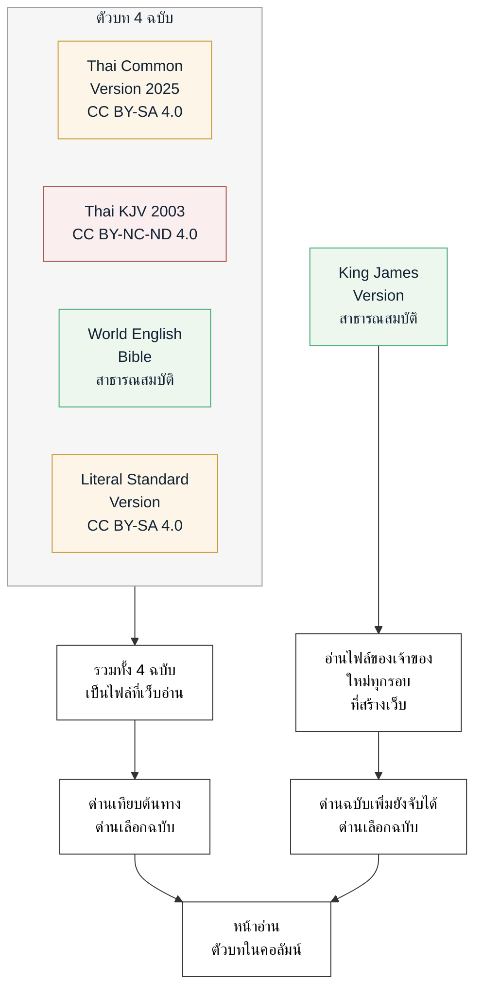

ตัวบท 5 ฉบับ คือ Thai Common Version 2025, Thai KJV 2003, World English Bible, Literal Standard Version และ King James Version เรารวม 4 ฉบับแรกเป็นไฟล์ที่เว็บอ่าน ไฟล์นั้นต้องผ่านด่านเทียบต้นทางและด่านเลือกฉบับ ส่วน King James Version เราอ่านจากไฟล์ของเจ้าของที่เก็บไว้ ใหม่ทุกรอบที่สร้างเว็บ แล้วนับว่าครบทุกข้อ และตัวบทตรงกับที่ตรวจไว้ทุกตัวอักษร ต้องผ่านด่านฉบับเพิ่มยังจับได้และด่านเลือกฉบับ ทั้ง 5 ฉบับไปเป็นตัวบทในคอลัมน์ของหน้าอ่าน ซึ่งคุณเลือกได้ว่าจะกางฉบับไหนบ้าง

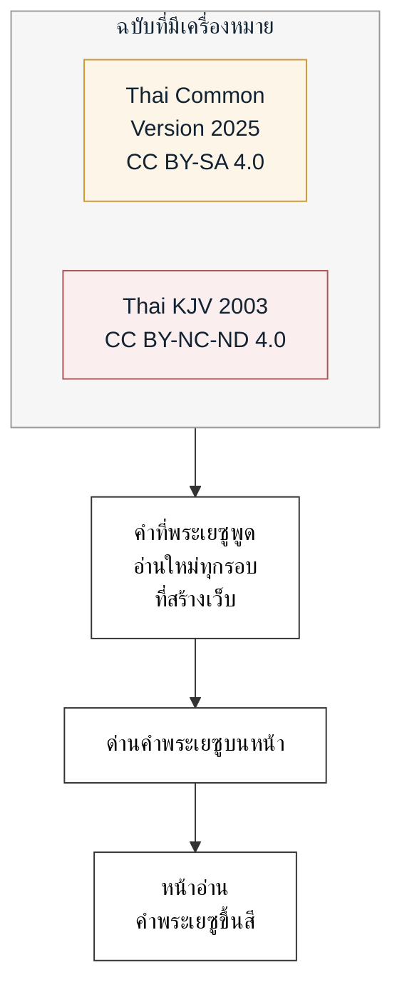

คำที่พระเยซูพูด เราอ่านจากไฟล์ของเจ้าของฉบับเองใหม่ทุกรอบที่สร้างเว็บ มีเฉพาะ Thai Common Version 2025 และ Thai KJV 2003 เพราะไฟล์ของเจ้าของมีเครื่องหมายนี้ และตัวบทในไฟล์ตรงกับที่เว็บใช้ ฉบับอื่นยังไม่มี ต้องผ่านด่านคำพระเยซูบนหน้า แล้วไปเป็นคำพระเยซูที่ขึ้นสีบนหน้าอ่าน

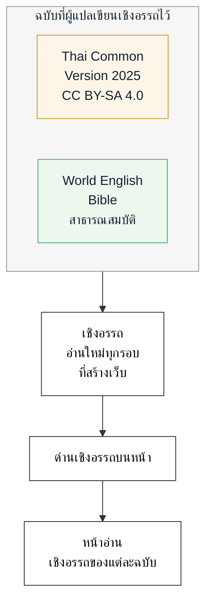

เชิงอรรถ เราอ่านจากไฟล์ของเจ้าของฉบับเองใหม่ทุกรอบที่สร้างเว็บ มีเฉพาะ Thai Common Version 2025 และ World English Bible เพราะผู้แปลสองฉบับนี้เขียนเชิงอรรถไว้ เชิงอรรถของฉบับไหนขึ้นเฉพาะในคอลัมน์ของฉบับนั้น ต้องผ่านด่านเชิงอรรถบนหน้า แล้วไปเป็นเชิงอรรถบนหน้าอ่าน

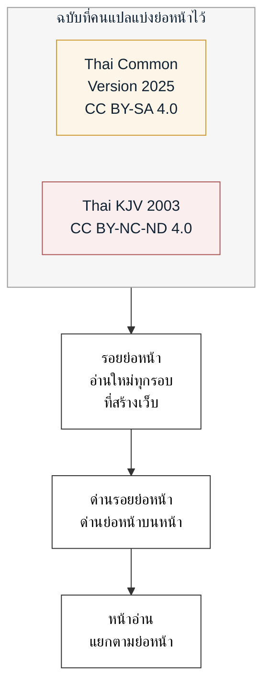

รอยย่อหน้าคือจุดที่คนแปลแต่ละฉบับแบ่งย่อหน้าไว้เอง เราอ่านจากไฟล์ของเจ้าของฉบับใหม่ทุกรอบที่สร้างเว็บ มีเฉพาะ Thai Common Version 2025 และ Thai KJV 2003 ฉบับอื่นยังไม่มี ต้องผ่านด่านรอยย่อหน้าและด่านย่อหน้าบนหน้า แล้วไปเป็นตัวเลือกแยกตามย่อหน้าบนหน้าอ่าน

#### 2. คำภาษาเดิม

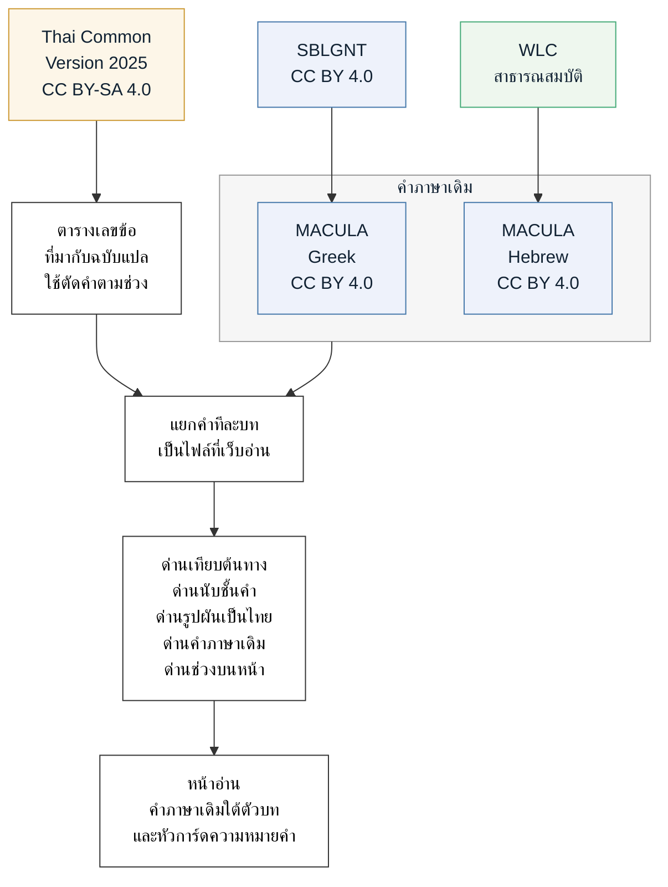

คำภาษาเดิมมาจาก MACULA Greek สำหรับพันธสัญญาใหม่ ซึ่งใช้ตัวบท SBLGNT และ MACULA Hebrew สำหรับพันธสัญญาเดิม ซึ่งใช้ตัวบท WLC เราแยกคำทีละบทเป็นไฟล์ที่เว็บอ่าน ไฟล์นั้นต้องผ่านด่านเทียบต้นทาง ด่านนับชั้นคำ ด่านรูปผันเป็นไทย และด่านคำภาษาเดิม แล้วไปเป็นคำภาษาเดิมใต้ตัวบท กับหัวของการ์ดความหมายคำ คือรูปพจนานุกรม เลข Strong และรูปผัน ตอนคุณเลือกอ่านเป็นช่วง เราตัดคำภาษาเดิมให้เหลือเฉพาะข้อในช่วงด้วยตารางเลขข้อที่มากับ Thai Common Version 2025 เพราะฉบับแปลกับภาษาเดิมแบ่งข้อไม่ตรงกันทุกที่ การตัดนี้ต้องผ่านด่านช่วงบนหน้าด้วย

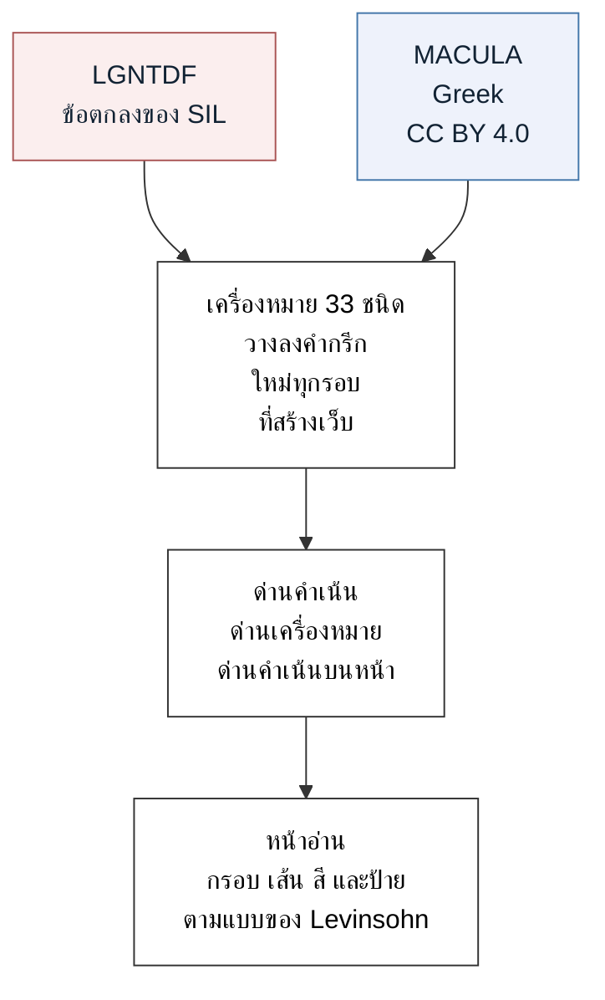

เครื่องหมายมาจาก LGNTDF ซึ่ง Stephen H. Levinsohn ทำไว้บนตัวบทกรีก NA27 ทั้งพันธสัญญาใหม่ ลิขสิทธิ์เป็นของ SIL International ข้อมูลมีเครื่องหมาย 33 ชนิด และเราแสดงครบทั้ง 33 ชนิด สีและเส้นบนคำกรีกทำตามแบบที่ Levinsohn ตั้งไว้เองในข้อมูล ยกเว้นที่เราต้องปรับเพื่อให้ทุกคนอ่านได้ชัด คือ เส้นสีเขียวกับตัวอักษรสีม่วงชมพูเข้มขึ้นให้อ่านชัดบนพื้นครีม สีพื้นทั้งสามสีอ่อนลง เราเติมอัญประกาศที่หัวท้ายคำพูดและคำพูดซ้อน เติมป้าย OT ให้ข้อความจากพันธสัญญาเดิม ป้าย OE ให้การเรียกเต็มกว่าปกติ และป้าย HP กับ HPerf ให้กริยาปัจจุบันเล่าอดีตกับกริยาสมบูรณ์เล่าอดีต เพื่อไม่ให้ต่างกันแค่สี ส่วนประโยคหลักกับหมายเหตุไม่มีแบบในข้อมูล เราจึงคิดแบบแสดงเอง ชื่อตระกูล ชื่อไทย และความหมายภาษาไทยเป็นของเราเอง ไม่ใช่ของ Levinsohn เราวางเครื่องหมายลงบนคำกรีกของ MACULA Greek ที่สะกดตรงกัน ใหม่ทุกรอบที่สร้างเว็บ คำที่จับไม่ได้ต้องอยู่ในบัญชีที่คนอ่านทวนแล้ว ต้องผ่านด่านคำเน้น ด่านเครื่องหมาย และด่านคำเน้นบนหน้า แล้วไปขึ้นบนคอลัมน์คำภาษาเดิมฝั่งกรีก ซึ่งเปิดปิดได้ทีละตระกูลที่แผง เครื่องหมายช่วยอ่าน ตอนแรกเปิดไว้แค่ตระกูลกรอบสีแดง

#### 3. พจนานุกรม

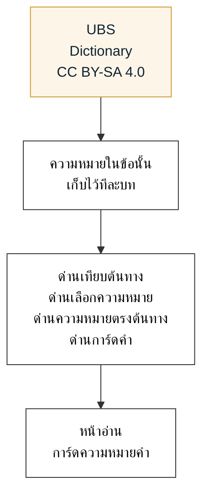

UBS Dictionary ให้ความหมายที่คำนั้นใช้ในข้อนั้น เราจับคู่คำกับความหมายแล้วเก็บไว้ทีละบท ต้องผ่านด่านเทียบต้นทาง ด่านเลือกความหมาย ด่านความหมายตรงต้นทาง และด่านการ์ดคำ แล้วไปเป็นการ์ดความหมายคำที่ขึ้นเมื่อคุณกดคำภาษาเดิม

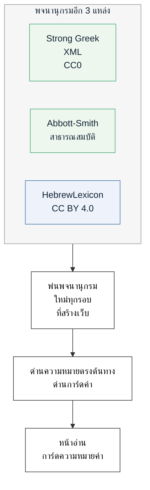

พจนานุกรมอีก 3 แหล่งคือ Strong Greek XML, Abbott-Smith และ HebrewLexicon ซึ่งให้ทั้ง Strong ฝั่งฮีบรูและ BDB เราอ่านจากไฟล์ของเจ้าของใหม่ทุกรอบที่สร้างเว็บ ต้องผ่านด่านความหมายตรงต้นทางและด่านการ์ดคำ แล้วไปเป็นการ์ดความหมายคำเหมือนกัน คุณเลือกเองได้บนการ์ดว่าจะดูจากพจนานุกรมเล่มไหน

#### 4. เสียง

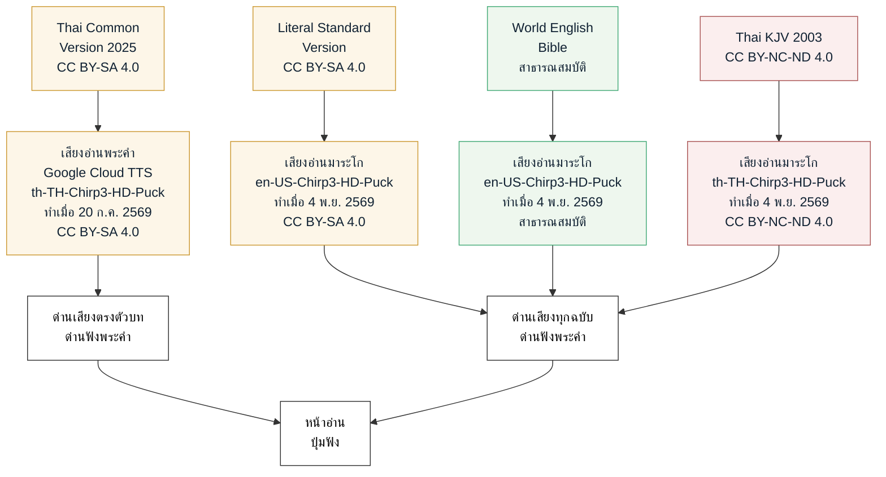

เสียงอ่านพระคำของ Thai Common Version 2025 ทำเมื่อ 20 ก.ค. 2569 ด้วยเครื่องอ่านออกเสียง Google Cloud TTS เสียง th-TH-Chirp3-HD-Puck เสียงนี้ดัดแปลงจากตัวบท จึงอยู่ใต้สัญญา CC BY-SA 4.0 ต้องผ่านด่านเสียงตรงตัวบทและด่านฟังพระคำ อีก 3 ฉบับมีเสียงเฉพาะพระธรรมมาระโก ทำเมื่อ 4 พ.ย. 2569 ด้วยเครื่องเดียวกัน Literal Standard Version กับ World English Bible ใช้เสียง en-US-Chirp3-HD-Puck เสียงของ Literal Standard Version ดัดแปลงจากตัวบท จึงอยู่ใต้สัญญา CC BY-SA 4.0 เสียงของ World English Bible เป็นสาธารณสมบัติเหมือนตัวบท Thai KJV 2003 ใช้เสียง th-TH-Chirp3-HD-Puck อ่านคำต่อคำ ไม่ดัดแปลง จึงอยู่ใต้สัญญา CC BY-NC-ND 4.0 เหมือนตัวบท เสียง 3 ฉบับนี้ต้องผ่านด่านเสียงทุกฉบับและด่านฟังพระคำ ทุกฉบับไปเป็นปุ่มฟังบนหน้าอ่าน ปุ่มฟังอ่านฉบับของคอลัมน์ที่คุณกำลังอ่าน

#### 5. เรื่องเล่า

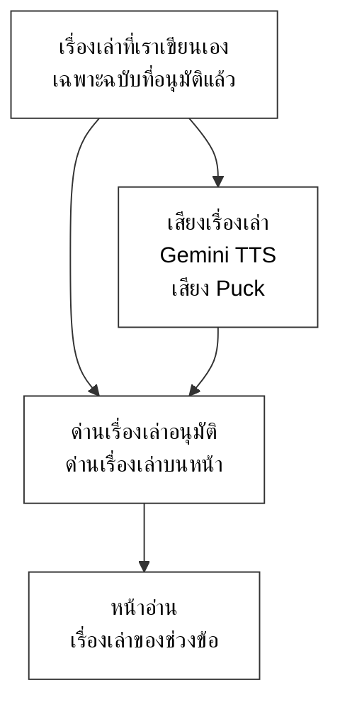

เรื่องเล่าคือร้อยแก้วภาษาง่ายที่เราเขียนเองจากการศึกษาช่วงข้อนั้น ขึ้นเว็บได้เฉพาะฉบับที่ผู้ดูแลเว็บอนุมัติแล้ว เสียงเรื่องเล่าทำจากตัวเรื่องฉบับเดียวกันด้วยเครื่องอ่านออกเสียง Gemini TTS เสียง Puck ทั้งตัวเรื่องและเสียงต้องผ่านด่านเรื่องเล่าอนุมัติและด่านเรื่องเล่าบนหน้า แล้วไปเป็นปุ่มเรื่องเล่าที่แถบล่างของหน้าอ่าน กดแล้วเปิดเป็นแผ่นที่อ่านและกดฟังได้ ปุ่มนี้โผล่เฉพาะตอนข้อบนจอทับช่วงที่มีเรื่องเล่า

#### 6. ตัวอักษร

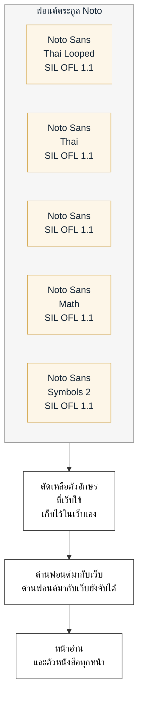

ฟอนต์ 5 ชุดมาจากตระกูลเดียวกัน คือ Noto Sans Thai Looped สำหรับตัวไทยแบบมีหัว Noto Sans Thai สำหรับตัวไทยแบบไม่มีหัว Noto Sans สำหรับตัวอังกฤษและตัวเลข Noto Sans Math กับ Noto Sans Symbols 2 สำหรับลูกศรและเครื่องหมายไม่กี่ตัวที่สามชุดแรกไม่มี เราตัดแต่ละชุดให้เหลือเฉพาะตัวอักษรที่เว็บใช้ แล้วเก็บไว้ในเว็บเองพร้อมไฟล์สัญญา ต้องผ่านด่านฟอนต์มากับเว็บและด่านฟอนต์มากับเว็บยังจับได้ แล้วไปเป็นตัวหนังสือบนหน้าอ่านและทุกหน้าของเว็บ เครื่องของคุณโหลดเฉพาะตัวไทยแบบที่คุณเลือกที่ปุ่ม Aa

สีในภาพบอกว่าแหล่งนั้นมีเงื่อนไขแบบไหน เขียวคือตัวข้อมูลเป็นของกลาง น้ำเงินคือขอแค่บอกชื่อ เหลืองคือบอกชื่อแล้วต้องแจกต่อฟรีด้วย แดงคือเจ้าของเขียนเงื่อนไขพิเศษของตัวเองไว้ กล่องสีขาวคือขั้นที่เราทำเอง ด่านตรวจ และส่วนของหน้าอ่าน

