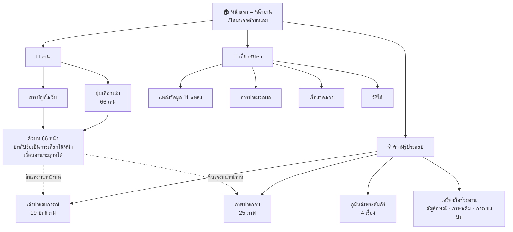

# ภาพรวมทั้งเว็บ — มีกี่หน้า เมนูจัดยังไง กดกี่ครั้งถึงตัวบท

> พี่เอมสั่ง 5 ก.ย. 2569 *"ทำภาพรวมทั้งเว็บ เมนูจัดยังไง กดกี่ครั้งถึงตัวบท"*
> ไฟล์นี้เป็น **ข้อเสนอ ยังไม่ใช่ของที่เคาะแล้ว** ⇒ เคาะเมื่อไรค่อยย้ายข้อสรุปไป [`สิ่งที่เคาะแล้ว.md`](../%E0%B8%AA%E0%B8%B4%E0%B9%88%E0%B8%87%E0%B8%97%E0%B8%B5%E0%B9%88%E0%B9%80%E0%B8%84%E0%B8%B2%E0%B8%B0%E0%B9%81%E0%B8%A5%E0%B9%89%E0%B8%A7.md)

## ผมเปิดอะไรดูก่อนเขียน

| เปิดอะไร | ได้อะไรมา |
| --- | --- |
| `C:\gh\phrakham2` นับไฟล์ `.qmd` จริง | รุ่น 2 มี **58 หน้า** (59 ไฟล์ ลบไฟล์ประกอบ 1) |
| `_quarto.yml` ของรุ่น 2 | เมนูตอนนี้มี **4 หัว** เล่าประสบการณ์ · ความรู้ประกอบ (5 ย่อย) · เพลง · เกี่ยวกับเรา |
| หัวไฟล์บทความทุกใบใน `reflections/` | ทุกบทความบอกอยู่แล้วว่าตัวเองอยู่ **เล่มไหน บทไหน ข้อไหน** (`passage`, `book-order`, `chapter`, `verse`) |
| หัวไฟล์ภาพทุกใบใน `figures/` | ภาพก็บอกเล่มกับบทไว้ในช่อง `categories` |
| `public/data` ของรุ่น 3 | มีเนื้อบทครบ **1,189 บท** เป็นไฟล์แยกบทละไฟล์แล้ว |
| `app/pages` ของรุ่น 3 | ยังว่าง มีแต่ตัวรับที่อยู่ทั่วไป ⇒ **โครงเว็บยังไม่มีใครวางเลย** |
| `references/ux-rules.md` และ `rule-of-3-research.md` | ข้อบังคับที่กำหนดโครง (อยู่หัวข้อถัดไป) |

> ⚠️ **แก้แล้ว 6 ก.ย. 2569 — พี่เอมเคาะว่า *1 เล่ม = 1 หน้า*** (ใบงาน v3/phrakham#73)
> > *"ผมว่าควรนับได้แค่ 66 หน้า คือแต่ละเล่ม ตัวบทและข้อคือการเลือกภายใน ไม่ใช่หน้า"*
>
> ⇒ **ตัวบทเหลือ 66 หน้า ⛔ ไม่ใช่ 1,189 หน้า** · บทกับข้อเป็นคำถามท้ายที่อยู่ `?c=119&v=1`
> ⇒ ที่อยู่เดิม `/read/<เล่ม>/<บท>` **ยังเปิดได้ตอนโค้ดของเว็บทำงาน** ⇒ มันพาไปตำแหน่งที่ถูกในหน้าของเล่มนั้น
> ⇒ ⚠️ **โค้ดโหลดไม่สำเร็จ ผู้อ่านจะได้หน้าสำรองที่มีลิงก์ให้กดต่อ ⛔ ไม่ใช่บทที่ขอ** ⇒ ดู *อะไรที่ยังไม่ได้พิสูจน์* ข้อ 7
> ⇒ ⚠️ **ราคาที่จ่ายคือกูเกิลเห็นน้อยลง** ⇒ ดูหัวข้อ *อะไรที่ยังไม่ได้พิสูจน์* ข้อ 3

## ของที่ต้องเก็บให้ครบ — ตัวบท 66 หน้า บวกของอื่นอีกราว 70 หน้า

| กอง | รุ่น 2 มี | รุ่น 3 จะมี |
| --- | --- | --- |
| ตัวบทพระคัมภีร์ | **0 หน้า** (ทั้งเล่มวาดด้วยโค้ดบนหน้าเดียว) | **66 หน้า** เล่มละหน้า ⇒ บทกับข้อเป็นการเลือกภายในหน้า |
| เล่าประสบการณ์ | 19 บทความ + 1 หน้ารวม | เท่าเดิม |
| ภาพประกอบ | 25 ภาพ + 1 หน้ารวม | เท่าเดิม |
| ภูมิหลังพระคัมภีร์ | 4 เรื่อง + 1 หน้ารวม | เท่าเดิม |
| เครื่องมือช่วยอ่าน | สัญลักษณ์ภาษาเดิม · สิ่งที่ภาษาเดิมอยากบอกเรา · การแบ่งบทและข้อ | เท่าเดิม |
| เรื่องของเรา | เกี่ยวกับเรา · วิธีใช้ | เท่าเดิม |
| ที่มาของข้อมูล | **ไม่มีเลย** | แหล่งข้อมูล 1 + 11 หน้าย่อย · การประมวลผล 1 |
| สารบัญทั้งเว็บ | ไม่มี | **1 หน้า (ของบังคับ อ่านหัวข้อถัดไป)** |
| เพลง | เว็บแยกต่างหาก | เท่าเดิม ไม่รวมมา |

## 6 ข้อที่บังคับโครง ⛔ ไม่ใช่ของที่เลือกได้

1. **ตัดช่องค้นหาแล้ว ⇒ ต้องมีหน้าสารบัญ** — มาตรฐาน WCAG 2.2 ข้อ 2.4.5 ระดับ AA บอกว่าต้องมี **มากกว่า 1 ทาง** ที่จะหาหน้าเจอ ปกติคือช่องค้นหากับเมนู พอตัดช่องค้นหาไป เหลือทางเดียวคือเมนู ⇒ **ตกมาตรฐานทันที** ⇒ ต้องเติมหน้าสารบัญที่ลิสต์ทุกหน้าเข้ามาแทน · ข้อนี้ยังพอดีกับเรื่องกูเกิลด้วย เพราะกูเกิลใช้หน้าสารบัญเดินเก็บหน้าของทั้ง 66 เล่ม
2. **เมนูบนสุดมี 3 หัว** — งานวิจัยของกลางเรื่องเลข 3 (`references/rule-of-3-research.md` ที่อัมกิต ห้อง `aimagin/way`) บอกว่าคนจำของพร้อมกันได้ 3 ถึง 4 ชิ้น เกินกว่านั้นชิ้นแรกจะหลุด · รุ่น 2 มี 4 หัวอยู่แล้ว และรุ่น 3 มีของเพิ่มอีก 2 กอง ⇒ ปล่อยไว้จะกลายเป็น 6 หัว
3. **เมนูอยู่ที่เดิมทุกหน้า** — ข้อ 3.2.3 ระดับ AA · แปลว่าหน้าของทั้ง 66 เล่มต้องมีเมนูชุดเดียวกับหน้าอื่น ⛔ ห้ามทำหน้าอ่านให้พิเศษกว่าเพื่อน
4. **ทุกหน้าต้องมีชื่อที่บอกว่าเป็นหน้าอะไร และไม่ซ้ำกัน** — ข้อ 2.4.2 ระดับ A · 66 หน้าต้องได้ชื่อคนละชื่อ · และชื่อหน้าเดินตามบทที่กำลังอ่าน เช่น *มาระโก 4 — อ่านพระคัมภีร์* ⛔ ไม่ใช่ชื่อเดียวกันหมด
5. **ปุ่มต้องใหญ่อย่างน้อย 44 จุด** — เรารับข้อ 2.5.5 ระดับ AAA มาเป็นกฎบ้านเรา · เรื่องนี้กระทบปุ่มเลือกเล่มโดยตรง เพราะ 66 เล่มต้องเรียงกันในจอมือถือ
6. **ตัดของรกได้ แต่ทุกอย่างต้องยังมีทางไปถึง** — NN/g ข้อ 8 · แปลว่าเอาของออกจากเมนูได้ ถ้ายังมีทางอื่นไปถึง

## แผนที่เว็บที่ผมเสนอ

> ⭐ **พี่เอมเคาะ 5 ก.ย. 2569** ว่าเมนูมี 3 หัวเท่านี้ คือ **อ่าน · เกี่ยวกับเรา · ความรู้ประกอบ**
> ⇒ แหล่งข้อมูลกับการประมวลผลไปอยู่ใต้ *เกี่ยวกับเรา* ⛔ ไม่ตั้งเป็นหัวที่สี่

เส้นประข้างล่างคือของที่ผมเจอตอนเปิดไฟล์ดู และมันเปลี่ยนเรื่องเมนูไปเยอะ อ่านหัวข้อ *ของที่เจอ* ข้างล่าง

## ⭐ อ่านต้องข้ามบทได้ — พี่เอมเคาะ 5 ก.ย. 2569

**พี่เอมสั่งว่า** *"ความจริงคือ เราดูข้ามบทได้ เพราะอยู่บนพื้นฐานว่าเดิมเป็นหนังสือเล่มเดียว และ บท ข้อ มาทีหลัง"*

ผมเสนอไว้ตอนแรกว่าหน้าบทเป็นหน้าที่จบในตัว อ่านจบบทแล้วกดไปบทถัดไป **ซึ่งผิด**
เพราะมันเอาเส้นที่คนขีดทีหลังมาทำเป็นกำแพงจริง ทั้งที่ต้นฉบับไม่มีเส้นนั้น

| ที่ผมเสนอไว้ตอนแรก | ที่พี่เอมเคาะ |
| --- | --- |
| หน้าบทจบในตัว ต้องกดไปบทถัดไป | **เลื่อนอ่านต่อได้เลย ทะลุรอยบทไป ⛔ ไม่มีกำแพง** |
| เลขบทเป็นขอบเขตของหน้า | **เลขบทเป็นแค่ป้ายริมข้อความ** |

**หลักฐานจากของเราเอง** บทความที่พี่เอมเขียน 2 ใบจาก 19 ใบ คร่อมรอยบทอยู่แล้ว
คือ *มาระโก 2:23-3:6* กับ *กิจการ 24:27-25:27* ⇒ **หน่วยความหมายจริงไม่จบตรงรอยบท**

**อะไรที่ ⛔ ไม่เปลี่ยน** ทุกบทยัง**ชี้ด้วยที่อยู่ได้** ⇒ `/read/PSA?c=119` และที่อยู่เดิม
`/read/PSA/119` ก็ยังเปิดได้ **เมื่อโค้ดของเว็บทำงาน** ⇒ คนแชร์ลิงก์ต้องชี้จุดได้ และมาตรฐานข้อ 2.4.5 บังคับว่าต้องมีทางหาหน้าเจอมากกว่า 1 ทาง
⇒ **ชี้จุดได้ แต่การอ่านไม่แยก** สองเรื่องนี้อยู่ด้วยกันได้
⇒ ⚠️ **สิ่งที่เปลี่ยนคือฝั่งกูเกิล** ⇒ ไฟล์ที่ถูกสร้างไว้ล่วงหน้ามี 66 ไฟล์ ⇒ ดูข้อ 3 ของหัวข้อสุดท้าย

**ที่ยังตอบไม่ได้ และผมส่งไปถามฝั่งข้อมูลแล้ว** ⇒ ถ้าไม่ใช้รอยบท แล้ว **อะไรคือรอยแบ่งของจริง**
ต้นฉบับมีเครื่องหมายย่อหน้ากับหัวข้อย่อยติดมาไหม หรือถูกตัดทิ้งตอนแปลงข้อมูล ⇒ อ่านคำถามเต็มในใบ #6

## 3 แบบ ที่ต่างกันตรงว่าหัวเมนูกดแล้วเจออะไร

### แบบ ก — กดหัวเมนูแล้วไปหน้ารวมที่มีการ์ด ⭐ ผมเสนอแบบนี้

กด *ความรู้ประกอบ* แล้วไปโผล่หน้าจริงหน้าหนึ่ง ที่มีการ์ด 4 ใบพร้อมภาพและคำอธิบายสั้น ๆ

**ข้อดี** หน้ารวมเป็นหน้าจริงที่กูเกิลเก็บได้ ⇒ คนค้นกูเกิลเจอทางเข้าเพิ่มอีกทาง · การ์ดใส่ภาพกับคำอธิบายได้ เมนูหล่นลงมาใส่ไม่ได้ · บนมือถือกดง่ายกว่าเพราะไม่ต้องเล็งของเล็ก ๆ ในเมนูซ้อน · เก็บของ 4 ถึง 6 ชิ้นได้สบาย ไม่ชนข้อจำกัดว่าคนจำได้ทีละ 3 ถึง 4 ชิ้น

**ข้อเสีย** คนที่รู้อยู่แล้วว่าจะไปหน้าไหน ต้องกดเพิ่มอีก 1 ครั้ง

### แบบ ข — กดหัวเมนูแล้วเมนูหล่นลงมา เหมือนรุ่น 2

**ข้อดี** คนที่รู้ว่าจะไปไหน กดน้อยกว่าแบบ ก อยู่ 1 ครั้ง · เหมือนของเดิมที่พี่เอมคุ้นแล้ว

**ข้อเสีย** กูเกิลไม่เห็นเมนูหล่นลงมา ⇒ เสียทางเข้าไปฟรี ๆ ทั้งที่เราตัดช่องค้นหาไปแล้วและต้องพึ่งกูเกิล · ใส่ได้แต่ตัวหนังสือเปล่า ๆ · ของกอง *ความรู้ประกอบ* มี 6 ชิ้น ยาวเกินที่คนจำไหว

### แบบ ค — ไม่มีเมนูกลุ่มเลย เหลือแค่ปุ่มเลือกเล่ม ที่เหลือไปอยู่ท้ายหน้า

**ข้อดี** จอสะอาดที่สุด ตัวบทเด่นที่สุด ตรงกับที่พี่เอมบอกว่าชอบแบบที่เป็นอยู่

**ข้อเสีย** ของ 58 หน้าที่พี่เอมเขียนมาทั้งปี จะไม่มีใครเห็นเลยถ้าไม่เลื่อนลงไปสุดหน้า · ท้ายหน้าที่ยัดของ 12 ชิ้น ไม่ได้สะอาดกว่าเมนู 3 หัวจริง

## กดกี่ครั้งถึงตัวบท

นี่คือคำถามที่พี่เอมถาม ผมตอบแยกตามคนที่มา เพราะจำนวนครั้งไม่เท่ากัน

| ใครมา | กดกี่ครั้ง | ทำไม |
| --- | --- | --- |
| คนที่เคยอ่านแล้วกลับมาอ่านต่อ | **0** | เขาคั่นหน้าหรือเปิดจากประวัติของเบราว์เซอร์เอง ⇒ แต่ละบทมีที่อยู่ของตัวเอง · **นี่คือคนส่วนใหญ่** |
| คนที่มาจากกูเกิล | **0** | ลงตรงหน้าบทนั้นเลย เพราะแต่ละบทมีที่อยู่ของตัวเอง |
| อ่านต่อไปบทถัดไป | **0** | เลื่อนลงไปเรื่อย ๆ ทะลุรอยบทได้เลย |
| เปิดเว็บครั้งแรก แล้วอยากไปบทที่ต้องการ | **3** | หน้าแรก → เลือกพระธรรม → เล่ม ⇒ ได้บท 1 ของเล่มนั้น |
| อยากไปบทลึก ๆ ของเล่มนั้น | **4** | เติมขั้นเลือกบทต่อท้าย |

⚠️ **ตัวเลขชุดนี้ขยับตั้งแต่ 11 ต.ค. 2569** ⇒ หน้าแรกไม่กางบทรอไว้แล้ว และ ⛔ ไม่จำจุดที่ค้างไว้แล้ว ⇒ เจ้าของเรื่องคือ [`../เคาะ/หน้าจอกับการอ่าน.md`](../%E0%B9%80%E0%B8%84%E0%B8%B2%E0%B8%B0/%E0%B8%AB%E0%B8%99%E0%B9%89%E0%B8%B2%E0%B8%88%E0%B8%AD%E0%B8%81%E0%B8%B1%E0%B8%9A%E0%B8%81%E0%B8%B2%E0%B8%A3%E0%B8%AD%E0%B9%88%E0%B8%B2%E0%B8%99.md) หัวข้อ *หน้าหลัก*

**3 ครั้งคือพื้นที่ต่ำที่สุดจริง ๆ ของกรณีเลือกเอง** เพราะของมี 66 เล่ม แต่ละเล่มมีหลายสิบบท จะให้เหลือ 2 ครั้งต้องยัด 1,189 ตัวเลือกไว้ในจอเดียว ซึ่งกดไม่ได้จริงบนมือถือ ⇒ **ใครบอกว่าทำได้ 2 ครั้ง แปลว่าเขาซ่อนขั้นตอนหนึ่งไว้**

หน้าสารบัญกด 4 ครั้งซึ่งแย่กว่า ⇒ **มันไม่ใช่ทางหลัก** มันมีไว้ 2 อย่างคือให้ผ่านมาตรฐานข้อ 2.4.5 กับให้กูเกิลเดินเก็บบททั้งหมด

## ⭐ ของที่ผมเจอตอนเปิดไฟล์ดู และมันเปลี่ยนเรื่องเมนู

บทความทั้ง 19 ใบ **บอกอยู่แล้วในตัวมันเอง** ว่าอยู่เล่มไหนบทไหนข้อไหน ภาพทั้ง 25 ใบก็บอกเล่มกับบทไว้เหมือนกัน

แปลว่า **เครื่องรู้อยู่แล้วว่าบทความใบไหนกับภาพใบไหนคู่กับบทไหน** ⇒ หน้าบทแต่ละหน้าเอาของที่เกี่ยวกับบทนั้นมาแปะท้ายหน้าได้เอง โดยไม่มีใครต้องมานั่งลิงก์ทีละใบ

นี่สำคัญเพราะ **ของพวกนี้จะไปหาผู้อ่านเอง ตอนที่เขากำลังอ่านบทนั้นอยู่** ⛔ ผู้อ่านไม่ต้องเดินหาในเมนู ⇒ เมนูจึงไม่ต้องแบกภาระเป็นทางเดียวที่จะเจอของ ⇒ เลือกแบบ ก ที่กดเพิ่ม 1 ครั้งได้อย่างสบายใจ

**แต่ต้องบอกความจริงด้วย** บทความ 19 ใบครอบคลุมแค่ 8 บท จาก 1,189 บท คิดเป็น **ไม่ถึง 1 เปอร์เซ็นต์** ⇒ อีก 1,181 บทจะไม่มีอะไรมาแปะ ⇒ หน้ารวมบทความยังต้องมีอยู่ สำหรับคนที่อยากอ่านว่าพี่เอมเขียนอะไรไว้บ้าง

## อะไรจะไม่เปลี่ยน

- หน้าแรกยังคือหน้าอ่าน เปิดมาเจอตัวบทเลย ⛔ ไม่มีหน้าโปรย
- ยังไม่มีช่องค้นหา ตามที่พี่เอมยืนยัน
- 58 หน้าที่พี่เอมเขียนไว้ในรุ่น 2 อยู่ครบทุกหน้า ⛔ ไม่ตัดทิ้งสักหน้า
- เพลงยังเป็นเว็บแยก ไม่ยุบมารวม
- ที่อยู่เดิมของรุ่น 2 ยังใช้ได้ ⇒ ใครบุ๊กมาร์กไว้ไม่เจอหน้าเสีย

## อะไรที่ยังไม่ได้พิสูจน์

1. **ยังไม่ได้ลองของจริงกับคน** ทั้งหมดนี้มาจากมาตรฐานกับของที่ผมเปิดอ่าน ⛔ ยังไม่มีใครกดจริงแล้วบอกว่างง
2. **ยังไม่รู้ว่าปุ่มเลือกเล่ม 66 เล่มจะกดได้จริงไหมบนมือถือ** ถ้าปุ่มต้องใหญ่ 44 จุด 66 เล่มจะยาวมาก ต้องออกแบบแยกอีกใบ
3. ⚠️ **กูเกิลจะเก็บบทที่ ⛔ ไม่ได้ถูกสร้างไว้ล่วงหน้าได้ไหม ⇒ ยังไม่รู้** (ใบงาน v3/phrakham#73)
   หลังเปลี่ยนเป็น 1 เล่ม = 1 หน้า ไฟล์ที่สร้างไว้ล่วงหน้ามี **66 ไฟล์** ⇒ แต่ละไฟล์มีเนื้อของ **บทแรกของเล่ม**
   ⇒ บทที่เหลือถูกหยิบมาด้วยโค้ดตอนผู้อ่านเลื่อนถึงหรือกดเลือก
   ⇒ ⛔ **เรื่องให้กูเกิลค้นแทนช่องค้นหา จึงยังพิสูจน์ไม่ได้** ⇒ ต้องรอดูของจริงที่ Search Console
   ⇒ **ถ้ากูเกิลเก็บไม่ได้ ต้องกลับมาเคาะกันใหม่** ว่าจะยอมมีไฟล์ต่อบทเฉพาะเพื่อกูเกิล หรือยอมไม่มีช่องค้นหา
4. **ยังไม่ได้ปรึกษาสองที่ปรึกษาเรื่องโครงนี้** ตอนนี้ปรึกษาไปแค่เรื่องช่องค้นหา และได้แค่ 2 รอบจากฝั่งเดียว
5. ~~ยังไม่รู้ว่ารอยแบ่งของจริงคืออะไร~~ ✅ **ตอบแล้ว 6 ก.ย. 2569** ⇒ ฝั่งข้อมูลใส่ช่อง `รอยแบ่ง` ลงชั้นอ่านครบทุกบทแล้ว
   ⇒ ⭐ **และใส่มาเกินที่ขอ 2 อย่าง** ⇒ `เชิงอรรถ` กับ `คำพระเยซู` ⇒ **ทั้งคู่ยังไม่มีที่อยู่ในแบบ** ⇒ ต้องออกแบบเพิ่ม
6. **ยังไม่รู้ว่าเลื่อนอ่านทั้งเล่มจะหนักแค่ไหน** สดุดีมี 150 บท ถ้าโหลดทั้งเล่มทีเดียวอาจช้าเกินงบเวลาที่ตั้งไว้
7. ⚠️ **ที่อยู่เดิมยังเปิดได้ *เฉพาะตอนโค้ดของเว็บทำงาน*** (คนตรวจ !64 ทัก ② · 7 ก.ย. 2569)
   `/read/<เล่ม>/<บท>` ⛔ ไม่มีไฟล์ของตัวเองแล้ว ⇒ ที่วางเว็บส่ง `404.html` มาให้ แล้วโค้ดพาต่อเอง
   ⇒ **โค้ดโหลดไม่สำเร็จเมื่อไร ผู้อ่านได้หน้าสำรอง** ⇒ มีชื่อหน้ากับลิงก์เข้าเว็บ ⛔ ไม่ใช่จอขาว
   ⇒ ⛔ **แต่เขา ⛔ ไม่ได้บทที่กดมา** ⇒ ต้องเดินเข้าทางสารบัญเอง
   ⇒ **ตัวเฝ้าคือ `tools/ด่านไปถึงข้อ.mjs` ข้อ ⑩ค** ⇒ มันปิดโค้ดของเว็บแล้วเปิดที่อยู่เดิมจริง
8. ⚠️ **GitHub Pages จะเสิร์ฟ `404.html` ให้ไหม ⇒ ยังตอบไม่ได้จากที่เก็บนี้**
   GitLab Pages ตอบได้ (เอกสารของเขาบอกว่าลอง `/<โปรเจกต์>/404.html` ก่อน) ⇒ **ตรงกับที่เราวางไฟล์**
   ⇒ ฝั่ง GitHub ขึ้นกับว่าโฟลเดอร์ที่ปล่อยถูกวางที่ราก หรือวางใต้โฟลเดอร์ `v3/`
   ⇒ **เจ้าของเรื่องนั้นคือ `v3/pleng` → `tools/push-v3.sh`** ⛔ ใบนี้ ⛔ ไม่แตะ ⇒ **ต้องลองของจริงก่อนปล่อย**

