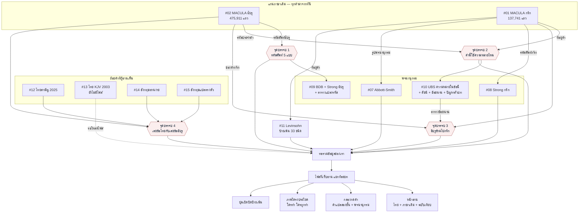
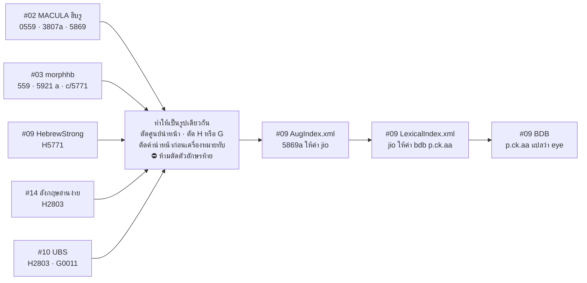
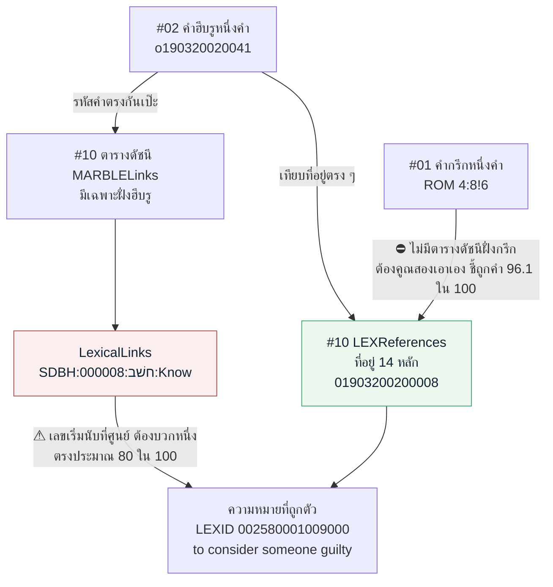
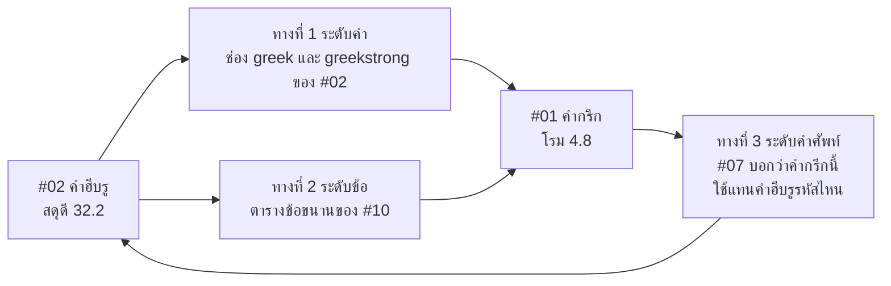
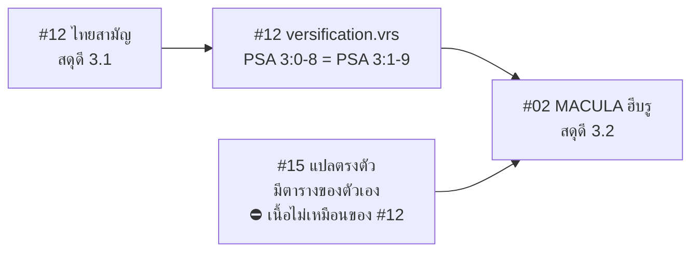

# ผังการไหล — ข้อมูลเดินจากแหล่งไปถึงหน้าจออย่างไร

ใบงาน [#43](https://aimgit.aimagin.com/v3/phrakham/-/issues/43) · เขียน 31 ส.ค. 2569

## เอกสารนี้ตอบอะไร

เอกสารคู่กันคือ [`พจนานุกรมข้อมูล.md`](พจนานุกรมข้อมูล.md) ตอบว่าช่องไหนมาจากไหน
เอกสารนี้ตอบว่าช่องเหล่านั้นเดินไปทางไหน และ **ไปบรรจบกันตรงไหน**

จุดบรรจบสำคัญ เพราะนั่นคือที่ที่ข้อมูลสองกองมาต่อกันแล้วต่อผิดได้โดยไม่มีอะไรเตือน
ตัวเลขจะยังออกมาสวย แต่ความหมายผิด

ผังนี้มีห้าอัน อันแรกเป็นภาพรวม อีกสี่อันเป็นจุดบรรจบทีละจุด

## ผังภาพรวม



**อ่านผังนี้อย่างไร** กล่องสี่เหลี่ยมเอียงสี่กล่องคือจุดบรรจบ อธิบายทีละจุดข้างล่าง
เส้นประคือของที่ยังไม่มีไฟล์

## จุดบรรจบ 1 — รหัสศัพท์ฮีบรูเขียนกันคนละแบบ 5 แบบ

คำฮีบรูคำเดียวกัน แต่ละแหล่งเขียนรหัสประจำคำไม่เหมือนกัน



**ทำไมจุดนี้พัง** รหัส `5869` ตัวเดียวถือได้สองความหมายที่ไม่เกี่ยวกัน คือตาคนกับตาน้ำ
ตัวอักษรท้ายรหัสเป็นตัวเดียวที่แยกสองอันนี้ออกจากกัน
ถ้าตัดตัวอักษรทิ้งแล้วค้นด้วยเลขเปล่า ๆ ตารางเชื่อมจะพาไปเจอตาน้ำก่อน เพราะมันอยู่ก่อนในไฟล์

**ของใหม่ที่ใบนี้เปิดเจอ** ไฟล์ `AugIndex.xml` ของ `#09` คือตารางแปลงตัวจริงของเจ้าของข้อมูล
มันแปลงรหัสแบบมีตัวอักษรท้าย ให้เป็นรหัสรายการในตารางเชื่อมโดยตรง
ไฟล์นี้เคยถูกจดไว้ว่ายังไม่ได้เปิด ที่ [`docs/บันทึก-แหล่งข้อมูล.md`](../บันทึก-แหล่งข้อมูล.md) หัวข้อ ⑩ ข้อ 4
⇒ **เปิดแล้ว และมันใช้ได้จริง** ⇒ ไม่ต้องคิดวิธีตัดเลขเอง

**วัดแล้วว่าเสี่ยงแค่ไหน** เอารหัสทุกแถวของ `#02` มาเดินผ่าน `AugIndex.xml` ทั้งกอง 475,911 แถว

| ผล | จำนวนแถว | ส่วนใน 100 |
|---|---|---|
| ต่อได้ตรง ๆ | 244,537 | 51.4 |
| มีตัวอักษรเกินมา ถอยออกแล้วต่อได้ | 169,915 | 35.7 |
| ⛔ **รหัสไม่มีตัวอักษร แต่ตารางมีให้เลือกหลายตัว ⇒ กำกวม** | **61,443** | **12.9** |
| ไม่มีใน BDB แต่มีในพจนานุกรม Strong | 11 | 0.0 |
| รูปแบบแปลก มีสองรหัสในช่องเดียว | 5 | 0.0 |

⭐ **แถวกลุ่มที่กำกวม 12.9 ใน 100 คือจุดที่หน้าจอจะแสดงคำอธิบายผิดเรื่องได้โดยไม่มีอะไรเตือน**
ตัวอย่างจริง คำที่ปฐมกาล 25.30 ตำแหน่ง 8 `#02` ให้รหัส `0122` เฉย ๆ ไม่มีตัวอักษรท้าย
แต่ตารางของ `#09` มีสองรายการคือ `122a` แปลว่า red กับ `122b` แปลว่า rosy ⇒ ต้องเลือกเอง

<!-- ไม่ต้องรัน: ต้องมีกอง _แตก 4.8 GiB ในเครื่อง ⇒ ตัวรันของอัมกิตไม่มีกอง -->

```
py -3.14 tools/วัดจุดบรรจบ.py รหัสฮีบรู
```

รันจากโฟลเดอร์บนสุดของที่เก็บ ⇒ สคริปต์อ่านกับนับอย่างเดียว ⛔ ไม่สร้างไฟล์อะไร

## จุดบรรจบ 2 — คำนี้ที่ข้อนี้ ใช้ความหมายไหน

นี่คือหัวใจของคำแปลสองชั้น พจนานุกรมทั่วไปให้มาสิบความหมายแล้วปล่อยให้เดา
`#10` ชี้ให้ว่าที่ข้อนี้ใช้ความหมายไหน แต่ทางเดินไปหามันมีสองทาง และสองทางไม่เท่ากัน



**ฝั่งฮีบรู** ตารางดัชนีของ `#10` ใช้รหัสประจำคำแบบเดียวกับ `#02` เป๊ะ ๆ จึงต่อได้ทันที
แต่ค่าที่ได้ในช่อง `LexicalLinks` ไม่ใช่รหัสความหมายตรง ๆ มันเป็นชื่อคำกับ **ลำดับที่เริ่มนับจากศูนย์**
เช่น `000008` แปลว่าความหมายที่เก้า ซึ่งตรงกับรหัส `002580001009000`
ตรวจกับไฟล์สดุดีทั้งไฟล์ 15,947 ลิงก์ โดยดูว่าชื่อหมวดความหมายที่ลิงก์บอก
ตรงกับชื่อหมวดของความหมายลำดับนั้นไหม

| ผล | จำนวนลิงก์ | ส่วนใน 100 |
|---|---|---|
| ชื่อหมวดตรงกัน | 12,727 | 79.8 |
| ⛔ ชื่อหมวดไม่ตรงเลย | 1,787 | 11.2 |
| ⛔ ลำดับเกินจำนวนความหมายที่มี | 952 | 6.0 |
| พจนานุกรมไม่มีชื่อหมวดให้เทียบ ⇒ ตรวจไม่ได้ | 428 | 2.7 |
| ไม่มีคำนั้นในพจนานุกรม | 53 | 0.3 |

⇒ **ทางนี้ใช้เป็นทางหลักไม่ได้**

**ทางที่แม่นกว่าคือเดินย้อน** พจนานุกรมเก็บรายชื่อข้อที่ใช้ความหมายแต่ละชั้นไว้เองในช่อง `LEXReferences`
เอาที่อยู่ของคำที่เราสนใจไปหาว่าอยู่ในรายชื่อของความหมายชั้นไหน ⇒ ได้คำตอบตรงตัว ไม่ต้องเดา
ตัวอย่างที่พิสูจน์แล้วอยู่ที่ [`docs/13-แหล่งให้อะไรเราได้บ้าง.md`](../13-แหล่งให้อะไรเราได้บ้าง.md) หัวข้อ `#10`

**ฝั่งกรีกไม่มีตารางดัชนีเลย** โฟลเดอร์ `index` ของ `#10` มีแต่ `WLC` ซึ่งเป็นฝั่งฮีบรู
⇒ ฝั่งกรีกเหลือทางเดียวคือแปลงที่อยู่ 14 หลักของ `#10` ให้เป็นที่อยู่คำของ `#01` เอง
กฎที่ใช้คือ ห้าหลักท้ายเป็นสองเท่าของลำดับคำ

⭐ **วัดกฎนี้ทั้งพันธสัญญาใหม่แล้ว** เอาที่อยู่ทุกอันในพจนานุกรมกรีก 130,790 จุด
หารสองแล้วไปดูว่าคำที่ตำแหน่งนั้นใน `#01` เป็นคำเดียวกับรายการพจนานุกรมไหม

⛔⛔ **ต้องตัดสินด้วยรูปพจนานุกรม ห้ามตัดสินด้วยรหัสศัพท์อย่างเดียว**
เพราะ `#01` กับ `#10` ใช้เลข Strong คนละระบบ `#01` ให้เลขตามรูปที่ผันแล้ว ส่วน `#10` ให้เลขของรูปตั้งต้น
⇒ **คำเดียวกันแท้ ๆ ก็ได้เลขคนละตัว** เช่นที่ `JHN 8:15!1` ทั้งสองฝั่งเป็นคำ `σύ` เหมือนกัน
แต่เลขเป็น `5210` กับ `4675` ⇒ นับด้วยรหัสจะตัดสินว่าผิดทั้งที่ถูก

| ผล | จำนวนจุด | ส่วนใน 100 |
|---|---|---|
| รหัสศัพท์ตรง ⇒ ชี้ถูกคำ | 117,499 | 89.84 |
| รหัสไม่ตรง แต่รูปพจนานุกรมตรง ⇒ **ก็ชี้ถูกคำ** | 8,173 | 6.25 |
| ต่างกันแค่เครื่องหมายเสียง เช่น `ἄλφα` กับ `Ἄλφα` ⇒ น่าจะถูกคำ | 11 | 0.01 |
| ⛔ **คำที่ถูกอยู่ตำแหน่งอื่นในข้อเดียวกัน ⇒ ชี้ผิดตำแหน่งจริง** | **3,263** | **2.49** |
| ทั้งข้อไม่มีรูปคำนั้นเลย ⇒ ยังตอบไม่ได้ | 1,199 | 0.92 |
| ไม่มีคำที่ตำแหน่งนั้น · ที่อยู่ไม่ใช่ 14 หลัก · ตำแหน่งเป็นเลขคี่ | 645 | 0.49 |

⇒ **กฎคูณสองชี้ถูกคำ 96.1 ใน 100** · ชี้ผิดตำแหน่งแน่ ๆ **2.49** · รวมของที่ยังตอบไม่ได้แล้วแย่ที่สุด **3.9**

⚠️ **รอบแรกของใบนี้เขียนไว้ว่าชี้ผิดคำ 9.7 ใน 100 ซึ่งสูงเกินจริงเกือบ 4 เท่า**
เพราะไปนับ "รหัสศัพท์ไม่ตรงกัน" แล้วเรียกมันว่า "ชี้ผิดคำ"
⇒ **เป็นกับดักเดียวกับที่เคยนับ BDB ได้ 560** คือตัวเลขถูก แต่นับคนละเรื่องกับที่พูด
⇒ คนตรวจจับได้ที่คำขอรวม [!27](https://aimgit.aimagin.com/v3/phrakham/-/merge_requests/27)

⇒ ⭐ **จุดนี้ยังไม่มีทางสำรอง** เพราะฝั่งกรีกไม่มีตารางดัชนีเลย
แต่พอวัดถูกแล้ว **มันไม่ใช่จุดที่เสี่ยงที่สุด** จุดที่เสี่ยงที่สุดคือรหัสศัพท์ฮีบรูที่กำกวม 12.9 ใน 100

**เลขเล่มของ `#10` นับจาก 001 ถึง 066** ปฐมกาลคือ `001` สดุดีคือ `019` มัทธิวคือ `040` โรมคือ `045`
⛔ **ถ้านับมัทธิวเป็น `041` จะเลื่อนทั้งพันธสัญญาใหม่** เราพลาดข้อนี้มาแล้วตอนวัดครั้งแรกในใบนี้เอง
⇒ ⭐ **เรื่องนี้เครื่องพิสูจน์ได้ จึงทำเป็นเทส** ⛔ ไม่ใช่เขียนยืนยันไว้เฉย ๆ
`วัดจุดบรรจบ.py เทสเลขเล่ม` หยิบที่อยู่ที่พจนานุกรมให้ไว้กับคำ `λογίζομαι` มาลองแปลงด้วยเลขเริ่ม 3 แบบ
⇒ แบบ `040` เท่านั้นที่พาไปเจอคำ `λογίζομαι` จริง ส่วน `039` ได้ `χωρίς` และ `041` ได้ `λέγω`

<!-- ไม่ต้องรัน: ต้องมีกอง _แตก 4.8 GiB ในเครื่อง ⇒ ตัวรันของอัมกิตไม่มีกอง -->

```
py -3.14 tools/วัดจุดบรรจบ.py ความหมายฮีบรู
py -3.14 tools/วัดจุดบรรจบ.py ความหมายกรีก
```

## จุดบรรจบ 3 — ข้ามจากฮีบรูไปกรีก

โจทย์คือ เปาโลยกสดุดี 32.1-2 ไปไว้ใน โรม 4.7-8 ⇒ หน้าเว็บควรกดข้ามไปมาได้
มีสองทางที่ทำได้ และทั้งสองทางไม่ต้องผูกเอง



**ทางที่ 1 ได้ละเอียดถึงระดับคำ แต่มีไม่ครบ** ช่อง `greekstrong` ว่างในหลายคำ
เช่นคำ อัสกิล ที่สดุดี 32.8 มีคำกรีกให้ แต่ไม่มีรหัสศัพท์

**ทางที่ 2 แม่นที่สุดแต่ได้แค่ระดับข้อ** ตารางข้อขนานของ `#10` มีคู่ที่เราต้องการอยู่แล้ว
คือสดุดี 32.1 คู่กับ โรม 4.7 และสดุดี 32.2 คู่กับ โรม 4.8
ทั้งไฟล์มี 2,193 กลุ่ม และมี 249 กลุ่มที่มีทั้งฝั่งฮีบรูและฝั่งกรีกอยู่ด้วยกัน

**ทางที่ 3 เดินย้อนจากกรีกไปฮีบรู** `#07` บอกในทุกรายการว่าคำกรีกนี้ใช้แทนคำฮีบรูรหัสไหน
แต่รูปคำฮีบรูที่เขาให้เป็นแบบไม่มีสระ ⇒ **ต้องเทียบด้วยรหัสเท่านั้น ⛔ ห้ามเทียบด้วยตัวอักษร**

**กับดักตัวอักษร** ตัวอักษรกรีกและฮีบรูที่มีเครื่องหมายเสียง เก็บได้สองแบบ
คือรวมเป็นตัวเดียว กับแยกตัวอักษรออกจากเครื่องหมาย เทียบตรง ๆ แล้วไม่ตรงทั้งที่เป็นคำเดียวกัน
พิสูจน์ไว้แล้วท้าย [`docs/13-แหล่งให้อะไรเราได้บ้าง.md`](../13-แหล่งให้อะไรเราได้บ้าง.md)
⇒ **ทุกจุดที่ข้ามภาษา ให้เทียบด้วยรหัสตัวเลข**

## จุดบรรจบ 4 — เลขข้อไทยกับเลขข้อฮีบรูไม่ตรงกัน

จุดนี้อันตรายเพราะมันเงียบที่สุด ข้อความไทยกับคำฮีบรูจะวางคู่กันได้สนิท แค่คนละข้อ



**พิสูจน์ด้วยสองคำสั่ง** สดุดี 3.1 ของฉบับไทยอ่านว่า "พระยาห์เวห์ ศัตรูของข้าพเจ้ามีมากเหลือเกิน"
ส่วนสดุดี 3.1 ของ `#02` เป็นหัวบทที่แปลว่า psalm of David when he fled from Absalom his son
⇒ ข้อความไทยข้อ 1 ตรงกับคำฮีบรู **ข้อ 2**

สาเหตุคือฉบับฮีบรูนับหัวบทเป็นข้อที่ 1 ส่วนฉบับไทยกับอังกฤษไม่นับ
ตารางแปลงในไฟล์ `versification.vrs` บอกไว้ให้แล้ว 258 บรรทัด ในนั้นเป็นสดุดี **63 บรรทัด**

⚠ **สดุดี 32 ไม่อยู่ในรายการ** เพราะบทนี้ฮีบรูรวมหัวบทไว้ในข้อ 1 อยู่แล้ว
⇒ **เอาสดุดี 32 มาทดลองแล้วผ่าน ไม่ได้แปลว่าทั้งเล่มผ่าน** ⇒ ต้องทดลองด้วยสดุดี 3 ด้วย

⚠ **`#12` กับ `#15` มีไฟล์ตารางแปลงคนละไฟล์และเนื้อไม่เหมือนกัน** ⛔ ห้ามใช้ตารางเดียวกับทั้งสองฉบับ

<!-- ไม่ต้องรัน: ต้องมีกอง _แตก 4.8 GiB ในเครื่อง ⇒ ตัวรันของอัมกิตไม่มีกอง -->

```
B=C:/gl/v3/phrakham/_แตก
grep -c '^PSA .* = ' "$B/tcv/usx-rev2-release/release/versification.vrs"
grep '^PSA 3:' "$B/tcv/usx-rev2-release/release/versification.vrs"
awk -F'\t' '$2 ~ /^PSA 3:[12]!/{print $2,$13}' "$B/macula-hebrew-main/WLC/tsv/macula-hebrew.tsv" | head -13
cmp -s "$B/lsv-rev32-release/release/versification.vrs" "$B/tcv/usx-rev2-release/release/versification.vrs" && echo เหมือนกัน || echo ไม่เหมือนกัน
```

ผลที่ควรได้ เลข `63` แล้วบรรทัด `PSA 3:0-8 = PSA 3:1-9`
แล้วคำฮีบรูของสดุดี 3.1 ซึ่งเป็นหัวบท ตามด้วยสดุดี 3.2 ที่ขึ้นต้นด้วย `LORD`
บรรทัดสุดท้ายพิมพ์ว่า `ไม่เหมือนกัน`

## ตารางสรุปจุดบรรจบทั้งหมด

เรียงจากเสี่ยงมากไปเสี่ยงน้อย **เกณฑ์คือ ถ้าเดินทางที่ดูตรงไปตรงมาที่สุดโดยไม่รู้กับดัก จะเสียหายแค่ไหน**
⛔ ไม่ได้เรียงตามตัวเลขดิบ เพราะบางจุดมีทางสำรองที่ปิดปัญหาได้หมด

| จุดบรรจบ | ต่ออะไรกับอะไร | กุญแจ | วัดแล้วเสี่ยงแค่ไหน | มีทางสำรองไหม |
|---|---|---|---|---|
| **รหัสศัพท์ฮีบรู** | `#02` กับพจนานุกรมของ `#09` | รหัสพร้อมตัวอักษรท้าย ผ่าน `AugIndex.xml` | ⛔ **กำกวม 12.9 ใน 100 จาก 475,911 แถว** | มี ถ้าไม่มีใน BDB ให้ถอยไปใช้พจนานุกรม Strong |
| **ความหมายฝั่งฮีบรูผ่านดัชนี** | `#02` กับพจนานุกรมของ `#10` | `LexicalLinks` ลำดับเริ่มนับที่ศูนย์ | ตรง 79.8 ใน 100 จาก 15,947 ลิงก์ในสดุดี ⇒ **ใช้เป็นทางหลักไม่ได้** | มี ใช้ `LEXReferences` แทน ซึ่งตรงตัว |
| **เลขข้อไทยกับฮีบรู** | `#12` `#15` กับ `#02` | ตาราง `versification.vrs` | เลื่อน 63 บทในสดุดี ถ้าไม่ใช้ตารางก็ผิดทั้ง 63 บท | มี ตารางอยู่ในไฟล์ที่เจ้าของแจกมาให้แล้ว |
| **ความหมายฝั่งกรีก** | `#01` กับพจนานุกรมของ `#10` | ที่อยู่ 14 หลัก หารห้าหลักท้ายด้วยสอง | ชี้ถูกคำ 96.1 ใน 100 · ผิดแน่ ๆ 2.49 · แย่ที่สุด 3.9 จาก 130,790 จุด | ⛔ **ไม่มี** ไม่มีตารางดัชนีฝั่งกรีก |
| **ลิงก์ปัญหาตัวบท** | ดัชนีของ `#10` กับไฟล์ `HOTTP.XML` | เลขในลิงก์ บวกหนึ่ง | ตรวจครบ 7,532 ลิงก์แล้ว บวกหนึ่งถูกทุกอัน ที่ระดับข้อ | ไม่ต้องมี กฎนิ่ง |
| **รหัสศัพท์กรีก** | `#01` กับ `#08` | เลข Strong ตัดศูนย์นำหน้า | ไม่มีเรื่องคำพ้องรูปเหมือนฝั่งฮีบรู | ใช้ `#07` เป็นตัวทาน |
| **ป้ายเน้นกับคำกรีก** | `#11` กับ `#01` | ที่อยู่คำ ต้องแปลงรูปชื่อเล่มและตัวคั่น | เลขตำแหน่งคำตรงกัน แปลงรูปแล้วต่อได้ | ไม่ต้องมี |
| **ข้อขนาน** | ตารางของ `#10` กับตัวบททุกฉบับ | เลขบทเลขข้อ | ได้แค่ระดับข้อ ไม่ถึงระดับคำ | ไม่ต้องมี |
| **รหัสติดคำอังกฤษ** | `#14` กับ `#02` | `w@s` | ⛔ ติดผิดตำแหน่งเยอะ ใช้ได้แค่ระดับข้อ | ไม่มี ⇒ ห้ามใช้ทำไฮไลต์ทีละคำ |

## สิ่งที่ผังนี้จงใจไม่ตอบ

**ไม่ได้ออกแบบตารางปลายทาง** กล่องที่เขียนว่าท่อรวมข้อมูลและไฟล์ที่เว็บอ่าน เป็นแค่ตำแหน่งในผัง
⛔ ไม่ใช่การออกแบบว่าจะเก็บอย่างไร นั่นเป็นใบถัดไป หลังใบ [#41](https://aimgit.aimagin.com/v3/phrakham/-/issues/41) วัดขนาดเสร็จ

**ไม่ได้บอกว่าหน้าจอหน้าตาเป็นอย่างไร** กล่องหน้าจอสี่กล่องบอกแค่ว่าข้อมูลไปโผล่ที่งานไหน
แบบหน้าจอตัวจริงเป็นของ WPA.10 ที่ยังไม่ได้เขียน

## อะไรที่ยังไม่ได้พิสูจน์

**กลุ่มที่ชี้ผิดตำแหน่ง 2.49 ใน 100 ยังไม่ได้ไล่ด้วยตา** รู้แค่ว่ารูปคำที่ถูกอยู่ที่อื่นในข้อเดียวกัน
⛔ ยังไม่รู้ว่าเลื่อนไปกี่ตำแหน่ง และเลื่อนเป็นแบบแผนเดียวกันหรือเปล่า
⇒ ถ้าเลื่อนเป็นแบบแผน อาจแก้ได้ด้วยกฎเพิ่มอีกข้อ ⇒ **ต้องเปิดดูก่อนจะสรุปว่าแก้อย่างไร**

**กลุ่มที่ยังตอบไม่ได้ 0.92 ใน 100 คือทั้งข้อไม่มีรูปคำนั้นเลย** อาจเป็นเพราะพจนานุกรมของ `#10`
กับตัวบทของ `#01` เป็นคนละฉบับพิมพ์ หรือเพราะแยกคำคนละแบบ ⛔ ยังไม่ได้เปิดดู

**วิธีเทียบรูปพจนานุกรมมีข้อจำกัด** คำที่รูปตั้งต้นเหมือนกันแต่เป็นคนละคำจริง ๆ จะถูกนับว่าถูก
⇒ ตัวเลข 96.1 อาจสูงไปเล็กน้อย ⛔ แต่ยังดีกว่าการนับด้วยรหัสศัพท์ ซึ่งพิสูจน์แล้วว่าตัดสินผิดเป็นหมื่นจุด

**ตัวเลข 12.9 ใน 100 ของฝั่งฮีบรู วัดว่าต่อไม่ได้แน่ ๆ กี่แถว** แต่ยังไม่ได้วัดว่าถ้าเดาโดยหยิบตัว `a`
เสมอ จะถูกกี่แถว ⇒ ยังตอบไม่ได้ว่าควรเดาหรือควรแสดงว่าไม่แน่ใจ

**ตัวเลข 79.8 ใน 100 ของดัชนีฝั่งฮีบรู วัดจากไฟล์สดุดีไฟล์เดียว** ยังไม่ได้กวาดทั้ง 39 เล่ม
และวิธีตรวจคือเทียบชื่อหมวดความหมาย ⇒ **ชื่อหมวดตรงไม่ได้แปลว่าเป็นความหมายเดียวกันเสมอ**
เพราะหลายความหมายของคำเดียวกันใช้ชื่อหมวดซ้ำกันได้

**`AugIndex.xml` ยังไม่ได้ทานกับ `LexicalIndex.xml` ทั้งไฟล์** เปิดดูตรงกันแค่สามรายการ
คือ `5869a` `5869b` และ `7919a`

**ยังไม่ได้ทดลองต่อจริงทั้งท่อ** ทุกตัวเลขในเอกสารนี้มาจากการวัดว่ากุญแจจับคู่กันได้ไหม
⛔ ยังไม่ได้สร้างไฟล์ผลลัพธ์แล้วเปิดดูว่าคำแปลออกมาถูกจริงหรือเปล่า

**`#13` Thai KJV ยังไม่มีไฟล์** ⇒ ทุกอย่างที่เกี่ยวกับฉบับนี้ในผังเป็นเส้นประ
