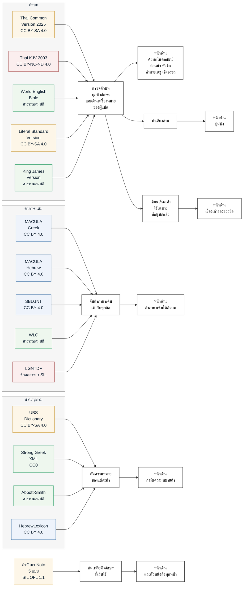

# ร่าง ⛔ ยังไม่ขึ้นเว็บ ⇒ ภาพรวมหน้าแหล่งข้อมูล (รูปเดียว)

**ที่มา** ⇒ @krisada 23 พ.ย. 2569 *"อยากได้รูปเดียวก่อน ที่บอกว่าเอาข้อมูลจากแหล่งไหน มาทำอะไร แล้วไปปรากฏตรงไหน"*
⇒ รูปแรก (6 แถว กลุ่ม → ส่วนของหน้า ไม่มีชื่อแหล่ง) ⇒ พี่เอม *"ไม่ OK ... มันไม่ช่วย"*
⇒ รูปที่ 2 (19 แหล่ง → 8 กล่องงาน) ⇒ พี่เอมถาม *"ซับซ้อนและซ้ำซ้อนบางจุดไหม"* ⇒ เส้นฝั่งตัวบทไขว้ · สองกล่องงานจบที่คอลัมน์เดียวกัน · ฟอนต์ 5 กล่องเหมือนกัน
⇒ **ร่างข้างล่างคือรูปที่ 3** ⇒ รวมกล่องที่ซ้ำแล้ว ⇒ **รอพี่เอมตอบว่ารูปแบบใช้ได้ไหม** (ยังไม่ตอบตอนย้ายเครื่อง)

**ทำต่อยังไง**
1. พี่เอมตอบว่ารูปใช้ได้ ⇒ วางบล็อกข้างล่างไว้ใน `content/แหล่งข้อมูล.md` เหนือ `
` ของแผนภาพละเอียด
2. ย่อหน้าใต้รูปเป็นของชั่วคราว ⇒ ให้ G ร่าง N ตรวจ ⇒ ต้องเอ่ยชื่อทุกแหล่งในรูป (ด่านแผนภาพข้อ ⑩) และบอกว่าเสียงอ่านมีแค่ 4 ฉบับ KJV ยังไม่มี ⇒ ส่งพี่เอมอนุมัติ
3. หัวข้อ *ภาพรวมข้อมูลบนเว็บ* ⇒ N เลือก (บันทึก `docs/ผลปรึกษา/19-ถ้อยคำแต่ละฉบับ.md`) แต่พี่เอมยังไม่ได้อนุมัติ
4. ด่าน `tools/ด่านแผนภาพตรงรายชื่อ.py` รู้จักกล่อง `O_` (กลุ่มในภาพรวม) แล้ว ⇒ ร่างนี้ผ่านด่านในเครื่อง

---

## ภาพรวมข้อมูลบนเว็บ

ย่อหน้าภาพรวม ร่าง Thai Common Version 2025 Thai KJV 2003 World English Bible Literal Standard Version King James Version MACULA Greek MACULA Hebrew SBLGNT WLC LGNTDF UBS Dictionary Strong Greek XML Abbott-Smith HebrewLexicon สีเขียว สีน้ำเงิน สีเหลือง สีแดง

