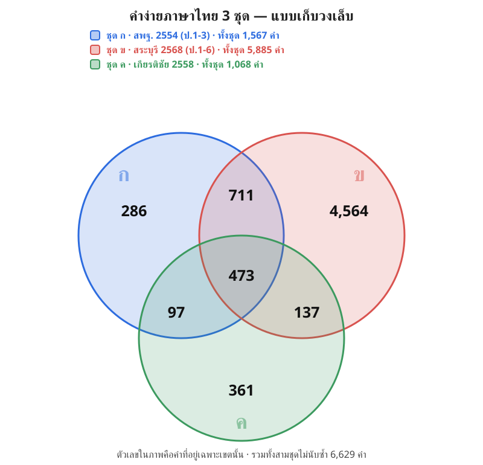

# คลังคำง่ายภาษาไทย — แหล่งที่ใช้ และผลการดึงคำ

> ⭐ **ไฟล์นี้เป็นตัวจริงของเรื่อง "คำง่ายภาษาไทยมาจากไหน ใช้ได้แค่ไหน ดึงออกมาได้เท่าไร"**
> ที่มา [ใบงาน #42](https://aimgit.aimagin.com/v3/phrakham/-/issues/42) และ
> [ใบงาน #44](https://aimgit.aimagin.com/v3/phrakham/-/issues/44) · เปิดของจริงทุกข้อ 31 ส.ค. 2569
> ⛔ แหล่งตัวบทพระคัมภีร์ 15 แหล่ง เป็นคนละเรื่อง อยู่ที่ [`บันทึก-แหล่งข้อมูล.md`](บันทึก-แหล่งข้อมูล.md)

## แหล่งที่ใช้มี 3 ชุด

| ชุด | คืออะไร | ครอบคลุม |
|---|---|---|
| **ก** | บัญชีคำพื้นฐาน ของ สพฐ. ปี 2554 | ป.1 ถึง ป.3 |
| **ข** | บัญชีคำพื้นฐานและคำศัพท์ ของ สพป.สระบุรี เขต 1 ปี 2568 | ป.1 ถึง ป.6 |
| **ค** | รายการคำศัพท์ 1,033 คำ ของ อ.เกียรติชัย เดชพิทักษ์ศิริกุล | คำที่ครูใช้สอนภาษาไทยให้นักศึกษาจีน |

## ทำไมต้องมีรายการคำง่าย

เราจะให้ AI เขียนคำอธิบายศัพท์ภาษาเดิม 14,298 คำ เป็นภาษาไทย
ถ้าปล่อยให้มันเลือกคำเอง มันจะใช้ศัพท์ยากจนคนอ่านไม่รู้เรื่อง
จึงต้องมีรายการคำง่ายไว้ก่อน แล้วบังคับให้เขียนด้วยคำในรายการเท่านั้น
พจนานุกรม Longman ใช้วิธีนี้ เขาจำกัดตัวเองไว้ที่ 2,000 คำ

⛔ **ก้าวนี้ยังไม่ใช่รายการ 2,000 คำฉบับสมบูรณ์** เป็นแค่การดึงของออกมาให้สะกดถูกก่อน

## ผลที่ได้ — ไฟล์ 5 ไฟล์

| ไฟล์ | ชุด | มาจาก | กี่แถว | มีอะไร |
|---|---|---|---|---|
| [`ข้อมูล/คำพื้นฐาน-ภาษาพูด.tsv`](ข้อมูล/คำพื้นฐาน-ภาษาพูด.tsv) | ก | บทที่ 4 (หน้า pdf 1-14) | 1,007 | คำที่เด็กพูด เรียงจากใช้บ่อยที่สุดลงมา |
| [`ข้อมูล/คำพื้นฐาน-แยกชั้น.tsv`](ข้อมูล/คำพื้นฐาน-แยกชั้น.tsv) | ก | บทที่ 5 (หน้า pdf 15-68) | 1,332 | คำเดียวกัน แยกว่าเป็นของ ป.1 ป.2 หรือ ป.3 |
| [`ข้อมูล/คำพื้นฐาน-พูดและเขียน.tsv`](ข้อมูล/คำพื้นฐาน-พูดและเขียน.tsv) | ก | ภาคผนวก (หน้า pdf 69-82) | 1,001 | คำที่เด็กทั้งพูดและเขียน |
| [`ข้อมูล/คำพื้นฐาน-สระบุรี-2568.tsv`](ข้อมูล/คำพื้นฐาน-สระบุรี-2568.tsv) | ข | 6 เล่ม ป.1-ป.6 | 10,836 | คำ + ชั้น + หมวดที่เขาจัดไว้ |
| [`ข้อมูล/คำพื้นฐาน-เกียรติชัย-1033.tsv`](ข้อมูล/คำพื้นฐาน-เกียรติชัย-1033.tsv) | ค | ตารางที่ 1 (หน้า pdf 1-38) | 1,033 | คำ + ป้ายกำกับหน้าที่ + ความถี่ + กลุ่มความถี่ |

**ลำดับครบทุกเลข ไม่มีขาดสักตัว** ⇒ จริงกับ 4 ไฟล์แรก
⛔ **ไฟล์ชุด ข ยังมีเลขที่ขาดอยู่** ⇒ กี่ตัวและเพราะอะไร อยู่ที่หัวข้อ ⑧ ข้อ 14

ไฟล์ที่สามนี้ ใบงานไม่ได้พูดถึง เราเจอเองตอนไล่หัวตารางทุกหน้า
และใบงานเขียนว่าบทที่ 4 มีถึงลำดับ 999 **ของจริงมีถึง 1,007** เปิดดูหน้า pdf 14 ยืนยันได้

ในบทที่ 5 คำของ ป.1 มี 993 คำ ป.2 มี 1,212 คำ ป.3 มี 1,332 คำ
ตั้งแต่ลำดับราว 1,026 ลงไป ช่อง ป.1 ว่าง เพราะคำของ ป.1 หมดก่อน

**สร้างไฟล์ใหม่ได้ตลอดด้วยคำสั่งเดียว**

<!-- ไม่ต้องรัน: ต้องมีไฟล์ PDF กับ royin.db ในเครื่อง ซึ่ง .gitignore กันไม่ให้ขึ้นที่เก็บ ⇒ ตัวรันของอัมกิตไม่มี · และ py -3.14 มีแต่ฝั่งวินโดวส์ -->

```sh
# ชุด ก
py -3.14 tools/ดึงคำพื้นฐาน.py <ไฟล์ pdf ตัวรายการคำ> docs/ข้อมูล/      # สร้างไฟล์ .tsv ใหม่
py -3.14 tools/ดึงคำพื้นฐาน.py <ไฟล์ pdf ตัวรายการคำ> --สำรวจ           # หลักฐานกฎซ่อม ำ
py -3.14 tools/ดึงคำพื้นฐาน.py <ไฟล์ pdf ตัวรายการคำ> --ตรวจ            # เทส 7 แถวที่อ่านจากภาพ
py -3.14 tools/ทานด้วยเครื่องมือตัวที่สอง.py <ไฟล์ pdf ตัวรายการคำ> docs/ข้อมูล
# ชุด ข ⇒ ใช้เวลาราว 20 นาที เพราะไฟล์รวมกัน 376 MB
py -3.14 tools/ซ่อมฟอนต์สระบุรี.py <ไฟล์ pdf เล่มใดเล่มหนึ่ง>            # หลักฐานว่าซ่อมฟอนต์ถูก
py -3.14 tools/ดึงคำสระบุรี.py <โฟลเดอร์ pdf 6 เล่ม> docs/ข้อมูล
py -3.14 tools/ดึงคำสระบุรี.py <โฟลเดอร์ pdf 6 เล่ม> --ตรวจ             # เทสว่าไม่มีคำหาย
# ชุด ค
py -3.14 tools/ดึงคำเกียรติชัย.py <ไฟล์ pdf ฉบับเต็ม> docs/ข้อมูล
py -3.14 tools/ดึงคำเกียรติชัย.py <ไฟล์ pdf ฉบับเต็ม> --ตรวจ            # เทสว่าครบ 1,033
# ตรวจทั้ง 5 ไฟล์ · และเทียบ 3 ชุดเป็น 3 วง
py -3.14 tools/ตรวจคำกับราชบัณฑิต.py docs/ข้อมูล <ไฟล์ royin.db>
py -3.14 tools/เทียบคำ3ชุด.py docs/ข้อมูล docs/ภาพ
py -3.14 tools/เทียบคำ3ชุด.py docs/ข้อมูล --ตัวอย่าง 12
```

**ไฟล์ royin.db มาจากไหน** ⇒ แอปพจนานุกรมราชบัณฑิตเป็นไฟล์ `.apk` ซึ่งเปิดเป็น zip ได้
ข้างในมี `assets/www/db_royin_dict_20190422.db` เป็น sqlite ⇒ คัดไฟล์นั้นออกมาใช้

## ① สัญญาอนุญาต — เอาไปใช้ได้แค่ไหน

⛔ **ผลสรุปข้อแรกสุด เราไม่เอาไฟล์ PDF ต้นทางขึ้นที่เก็บเลยสักไฟล์** เก็บแต่ตัวคำที่แปลงเป็นไฟล์ข้อมูลของเราเอง
⇒ `.gitignore` กันโฟลเดอร์ `source/คำพื้นฐานไทย/` ไว้แล้ว

**ช่อง "ใช้บนเว็บ" หมายถึงเอา *ตัวคำ* ไปใช้เท่านั้น** ⛔ ไม่ใช่เอาเนื้อบทความหรือหน้ากระดาษไปลง

| เอกสาร | ชุด | ขึ้นที่เก็บ | เอาตัวคำไปใช้บนเว็บ |
|---|---|---|---|
| บัญชีคำพื้นฐาน ป.1-3 ของ สพฐ. 2554 (ตัวรายการคำ) | ก | ได้แต่มีเงื่อนไข ⇒ **เลือกไม่เอาขึ้น** | ได้แต่มีเงื่อนไข |
| รายงานการศึกษาคำพื้นฐาน ของ สพฐ. 2554 (วิธีทำ) | ก | ได้ | ได้ |
| บัญชีคำพื้นฐาน ป.1-6 ของ สพป.สระบุรี เขต 1 ปี 2568 | ข | ได้แต่มีเงื่อนไข ⇒ **เลือกไม่เอาขึ้น** | ได้แต่มีเงื่อนไข |
| รายการ 1,033 คำ ฉบับเต็มที่ผู้วิจัยส่งมาให้เอง | ค | ⛔ **เลือกไม่เอาขึ้น** | **ได้** ผู้วิจัยอนุญาตเอง |
| วารสารสุทธิปริทัศน์ ปีที่ 29 ฉบับที่ 92 | ค | **ไม่ได้** | ได้แต่มีเงื่อนไข ⛔ **เนื้อบทความเอาไปไม่ได้เลย** |

**เงื่อนไขที่ว่าคืออะไร** — [พ.ร.บ. ลิขสิทธิ์ พ.ศ. 2537 มาตรา 12](https://th.wikisource.org/wiki/พระราชบัญญัติลิขสิทธิ์_พ.ศ._2537) บอกว่า
คนที่เอาข้อมูลมารวบรวม **โดยการคัดเลือกหรือจัดลำดับ** ได้ลิขสิทธิ์ในงานรวบรวมนั้น
แต่ไม่กระทบสิทธิในตัวข้อมูลเดิม แปลว่า **ตัวคำแต่ละคำไม่มีลิขสิทธิ์ แต่การจัดชุดจัดลำดับมี**

⇒ **เราจึงห้ามลอกลำดับเดิมมาทั้งดุ้นแล้วเอาขึ้นเว็บเป็นหน้าใหม่**
⇒ ต้องเรียงใหม่ตามการใช้งานของเรา หรือรวมกับแหล่งอื่นก่อน
⛔ ไฟล์ `.tsv` สามไฟล์ในที่เก็บนี้ **ยังคงลำดับเดิมไว้ เพราะเป็นของสำหรับทำงานต่อ ไม่ใช่ของขึ้นเว็บ**

**ทำไมชิ้นแรกจึงตอบว่า "ได้แต่มีเงื่อนไข" ไม่ใช่ "ได้"** — [มาตรา 7(4)](https://ipat.or.th/หมวดที่-1-ลิขสิทธิ์-ส่วนท/)
บอกว่ารายงานของทางราชการไม่มีลิขสิทธิ์ แต่ [มาตรา 14](https://th.wikisource.org/wiki/พระราชบัญญัติลิขสิทธิ์_พ.ศ._2537)
บอกว่าหน่วยงานรัฐมีลิขสิทธิ์ในงานที่ตัวเองสร้างสรรค์ขึ้น
เอกสารชุดนี้อยู่ก้ำกึ่งสองข้อนี้ และค้นแล้วไม่พบคำพิพากษาไทยที่ชี้ขาด
ทางที่เสี่ยงน้อยที่สุดจึงเป็นการไม่เอาไฟล์ขึ้น แล้วลิงก์ไปต้นทางแทน

**วารสารสุทธิปริทัศน์สงวนสิทธิ์เต็มรูปแบบ ไม่มี Creative Commons**
[หน้านโยบายของวารสาร](https://so05.tci-thaijo.org/index.php/DPUSuthiparithatJournal/about/submissions)
บอกว่าต้องขออนุญาตเป็นลายลักษณ์อักษรก่อนนำไปใช้ซ้ำ
และหน้า 3 ในตัวเล่มเขียนเองว่า **ลิขสิทธิ์บทความเป็นของผู้เขียนและวารสารสุทธิปริทัศน์**
⇒ **เจ้าของมีสองฝ่าย ไม่ใช่วารสารฝ่ายเดียว** ถ้าจะขอใช้ ต้องขอทั้งสองฝ่าย

### ชุด ข ของสระบุรี — เจ้าของคนละคนกับชุด ก จึงตรวจใหม่ทั้งหมด

⛔ **ผลตรวจของชุด ก ใช้กับชุด ข ไม่ได้** ชุด ก เป็นของ สพฐ. ส่วนชุด ข ทำโดย สพป.สระบุรี เขต 1

**เปิดดูของจริงแล้วไม่มีข้อความอนุญาต และไม่มีข้อความห้ามเลยสักคำ**
เปิด [หน้าประกาศบัญชีคำพื้นฐาน](https://www.srb1.go.th/บัญชีคำพื้นฐานและคำศัพ/) ·
[หน้าแนวทางการพัฒนาคุณภาพการอ่าน](https://www.srb1.go.th/แนวทางการพัฒนาคุณภาพกา/) ·
[หมวดเอกสารเผยแพร่](https://www.srb1.go.th/category/เอกสารเผยแพร่/) ·
[โฟลเดอร์ Google Drive ที่หน้าเว็บลิงก์ไป](https://drive.google.com/drive/folders/1Lf1e1hpUJpWKQSV7fqo02cjfE3TULn5q)
⇒ ทุกหน้ามีแต่ลิงก์ดาวน์โหลด ไม่มีเงื่อนไข ไม่มี Creative Commons · เว็บนี้ไม่มีหน้านโยบายการใช้งาน
⇒ ในเล่มทั้ง 6 เล่ม 307 หน้า ก็ไม่มีหน้าลิขสิทธิ์ ไม่มี ISBN ปกหลังมีแต่ตราหน่วยงาน

⇒ จึงต้องกลับไปดูตัวกฎหมาย ซึ่งก้ำกึ่งระหว่างมาตรา 7(4) กับมาตรา 14 เหมือนเดิม
⚠️ **แต่ชุด ข เสี่ยงกว่าชุด ก ชัดเจน** เพราะเล่มทำด้วย Canva มีภาพการ์ตูน ลายดอกไม้ ภาพถ่ายเด็ก
และหน้าคณะผู้จัดทำระบุ **"ฝ่ายออกแบบ"** ไว้ตรง ๆ ⇒ ตัวเล่มเป็นงานสร้างสรรค์ ไม่ใช่รายงานเปล่า ๆ
และภาพจาก Canva มีสัญญาของ Canva ซ้อนอยู่อีกชั้นที่เราไม่รู้ ⇒ **ทางที่ปลอดภัยคือไม่เอาไฟล์ขึ้น**

⚠️ **ของชุด ข มีที่ต้องระวังเพิ่ม คือ "การจัดหมวด"** เขาแบ่งคำเป็นหมวดตามลักษณะการสะกด
(คำที่ไม่มีตัวสะกด · คำที่มีตัวสะกดตรงมาตรา · คำที่ใช้สระลดรูป · คำที่มีอักษรนำ ฯลฯ)
การแบ่งหมวดและการกำหนดว่าคำไหนเป็นของชั้นไหน **คือการคัดเลือกและจัดลำดับตามมาตรา 12 เต็ม ๆ**
⇒ หยิบตัวคำมาได้ ⛔ **แต่ห้ามลอกโครงหมวดกับลำดับมาทั้งดุ้นแล้วทำเป็นหน้าเว็บใหม่**

### ชุด ค — ผู้วิจัยส่งฉบับเต็มมาให้เอง

⭐ **นี่คือชุดเดียวที่มีคนอนุญาตให้ตรง ๆ** อ.เกียรติชัยส่งไฟล์รายการคำฉบับเต็มมาทางอีเมล
หลักฐานอยู่ที่ `source/คำพื้นฐานไทย/หลักฐานอนุญาต-อีเมลอาจารย์เกียรติชัย-31-ส.ค.-2569.pdf`
เขาเขียนว่า **"เพื่อประโยชน์ทางวิชาการ"** และ **"หากอ้างอิง อ้างอิงจากบทความได้"**

⇒ แปลว่า **ตัวคำเอาไปใช้ได้** และเวลาอ้างอิงให้อ้างบทความในวารสาร ⛔ ไม่ใช่อ้างไฟล์ที่เขาส่งมา
⇒ ไฟล์ที่เขาส่งมาเป็นของส่วนตัวระหว่างเรากับเขา จึงไม่เอาขึ้นที่เก็บ

⭐⭐ **คำเตือนจากผู้วิจัยเอง ⇒ ข้อนี้เปลี่ยนโจทย์ของก้าวถัดไป**

> ประเด็นที่คุณกฤษฎาสนใจเป็นคำศัพท์เทคนิคที่มาจากคลังข้อมูลที่แตกต่างกับงานวิจัยนี้
> ดังนั้นน่าจะต้องทบทวนวรรณกรรมที่เกี่ยวข้องกับการสร้างรายการคำศัพท์ทางวิชาการและคำศัพท์เทคนิคด้วยครับ
> เพื่อให้ได้เกณฑ์การคัดเลือกคำศัพท์ที่เหมาะสมก่อนที่จะสร้างรายการคำศัพท์

⇒ **เอา 3 ชุดมารวมกันเฉย ๆ ไม่พอ** ต้องมีเกณฑ์ว่าคำไหนได้เข้ารายการของเรา ⇒ เป็นงานของใบถัดไป

### เครดิตที่ต้องเขียน

ชิ้นที่ 1 และ 2 มาจากที่เดียวกัน เขียนครั้งเดียวได้

> รายงานการศึกษาคำพื้นฐาน นักเรียนชั้นประถมศึกษาปีที่ 1-3 ปีการศึกษา 2554
> สำนักวิชาการและมาตรฐานการศึกษา สำนักงานคณะกรรมการการศึกษาขั้นพื้นฐาน กระทรวงศึกษาธิการ
> <http://academic.obec.go.th/web/document/view/158>

ชิ้นที่ 3 ถ้าได้ใช้ ⇒ ⭐ **ในเล่มมีสองบทความ คนละคน คนละวิชา ต้องเขียนเครดิตทั้งคู่**
(ชื่อไฟล์ก็บอกไว้แล้วว่า `2-บทความ` · ดูสารบัญหน้า pdf 8)

> เกียรติชัย เดชพิทักษ์ศิริกุล (2558) คำศัพท์พื้นฐาน 1,000 คำ ที่ใช้ในการเรียนการสอน
> วิชาภาษาไทยพื้นฐานสำหรับนักศึกษาชาวจีนของมหาวิทยาลัยธุรกิจบัณฑิตย์ที่เรียนภาษาไทยเป็นภาษาที่สอง
> วารสารสุทธิปริทัศน์ ปีที่ 29 ฉบับที่ 92 **หน้า 273-293**
> <https://so05.tci-thaijo.org/index.php/DPUSuthiparithatJournal/article/view/244528>

> พิชญ์นาฏ สุทธิสมณ์ (2558) รายการคำศัพท์พื้นฐาน 1,000 คำ ในการเรียนการสอนรายวิชา
> วิทยาศาสตร์และเทคโนโลยีเพื่อคุณภาพชีวิตและสังคม (SC 103) สำหรับนักศึกษาชาวจีน
> ที่ใช้ภาษาไทยเป็นภาษาที่สองของมหาวิทยาลัยธุรกิจบัณฑิตย์
> วารสารสุทธิปริทัศน์ ปีที่ 29 ฉบับที่ 92 **หน้า 294-303**

ชุด ข ⇒ อ่านจากหน้าปก หน้าคำนำ และหน้าคณะผู้จัดทำในเล่มจริง

> แนวทางการพัฒนาคุณภาพการอ่าน การเขียนภาษาไทย ผ่านบัญชีคำพื้นฐานและคำศัพท์
> ในการทดสอบการอ่าน การเขียน ชั้นประถมศึกษาปีที่ 1-6 (ฉบับปรับปรุง ปี 2568) เอกสารลำดับที่ 02/2568
> กลุ่มนิเทศ ติดตามและประเมินผลการจัดการศึกษา
> สำนักงานเขตพื้นที่การศึกษาประถมศึกษาสระบุรี เขต 1
> สำนักงานคณะกรรมการการศึกษาขั้นพื้นฐาน กระทรวงศึกษาธิการ เมษายน 2568
> <https://www.srb1.go.th/บัญชีคำพื้นฐานและคำศัพ/>

ตั้งคณะทำงานด้วยคำสั่ง สพป.สระบุรี เขต 1 ที่ 99/2568 ลงวันที่ 28 มีนาคม 2568
บรรณาธิการคือ นางสาวพณพร เกษตรเวทิน ศึกษานิเทศก์ · ชื่อคณะทำงานครบทุกคนอยู่หน้า 43 ของเล่ม ป.1

⚠️ ที่มาเดิมของบัญชีคำนี้เก่ากว่าปี 2554 — คำนำในตัวเล่มเขียนเองว่ากระทรวงศึกษาธิการ
โดยกรมวิชาการ ศึกษาไว้เมื่อ พ.ศ. 2529-2531 ฉบับ 2554 คือการทำใหม่เพราะของเดิมใช้มานานกว่า 25 ปี

## ② ชุด ก — กับดักของไฟล์ PDF และวิธีที่เราแก้

ใบงานเตือนไว้ว่าดึงข้อความจาก PDF นี้แล้วได้คำสะกดผิด
เราเปิดดูของจริงถึงระดับตัวอักษรแล้ว **สาเหตุมีอยู่อย่างเดียว**

ฟอนต์ Angsana New ในไฟล์นี้วาดสระ **ำ** ด้วยรูปตัวอักษร 2 ตัวต่อกัน
ตัวแรกไม่มีรหัสยูนิโคดกำกับไว้ โปรแกรมอ่าน PDF จึงคืนมาเป็น**ช่องว่างที่กว้างเป็นศูนย์**
คำว่า `ทำ` จึงออกมาเป็น `ท` + ช่องว่าง + `า` และคำว่า `น้ำ` ออกมาเป็น `น` + ช่องว่าง + `้` + `า`

**ช่องว่างกว้างศูนย์เป็นสัญญาณที่วัดได้จากตัวไฟล์ ไม่ใช่การเดา**
เราไล่ดูช่องว่างกว้างศูนย์**ทุกตัวในไฟล์** พบว่าตามหลังด้วย `า` หรือ `ำ` เสมอ ไม่มีข้อยกเว้นเลยสักตัว
⇒ พิสูจน์เองได้ด้วย `py -3.14 tools/ดึงคำพื้นฐาน.py <ไฟล์ pdf> --สำรวจ`
⇒ ซ่อมไปทั้งหมด 552 จุด (แก้ `า` เป็น `ำ` 170 จุด · ตัดช่องว่างหน้า `ำ` 382 จุด)

**เครื่องมือคนละตัวให้ผลไม่เท่ากันมาก** เราวัดด้วยวิธีเดียวกันคือ
เอาข้อความดิบที่ได้มาตัดเป็นคำ แล้วนับว่ากี่เปอร์เซ็นต์เจอในพจนานุกรมราชบัณฑิต

| เครื่องมือ | คำไม่ซ้ำ | เจอในพจนานุกรม |
|---|---|---|
| `pdftotext` (ที่ใบงานลองไว้) | 1,806 | 967 คำ **53.5%** |
| PyMuPDF ท่าที่เราเขียน | 1,608 | 1,340 คำ **83.3%** |

ของที่ `pdftotext` ได้แต่เราไม่ได้ เป็นคำที่พังชัด ๆ เช่น `กดั` (กัด) `กนั` (กัน) `กระด๊ึบ` (กระดึ๊บ) `กลบั` (กลับ)
คือสระกับวรรณยุกต์หลุดไปอยู่ผิดที่ ตรงกับที่ใบงานเตือนไว้ ⇒ **เราจึงไม่ใช้ `pdftotext`**

**ตรวจซ้ำด้วยเครื่องมือตัวที่สอง** เราดึงใหม่ทั้งไฟล์ด้วย `pdfplumber` ซึ่งเป็นคนละตัวกัน
⇒ รันเองได้ด้วย [`tools/ทานด้วยเครื่องมือตัวที่สอง.py`](../tools/ทานด้วยเครื่องมือตัวที่สอง.py)

ไฟล์ `.tsv` สามไฟล์รวมกันมี **ช่องที่มีคำอยู่ 5,545 ช่อง** แต่คำซ้ำกันเยอะ (บทที่ 5 คำเดียวกันวางสามช่อง)
⇒ **นับข้อความที่ไม่ซ้ำกันได้ 1,582 แบบ** ⇒ ตัวที่สองอ่านเจอครบ **1,582 แบบ คิดเป็น 100%**

⚠️ **วิธีเทียบสำคัญมาก** ⇒ ⛔ **ห้ามเอาผลของตัวที่สองมาตัดคำแล้วนับ** จะได้ราว 70%
ซึ่งวัดว่าเราตัดคำเก่งแค่ไหน ⛔ ไม่ได้วัดว่าอ่านตรงกันไหม เพราะ `pdfplumber`
แทรกช่องว่างและเรียงวรรณยุกต์ต่างจากตัวแรก
⇒ ⭐ **ที่ถูกคือถามว่า "คำที่เราจดไว้ โผล่ในสายอักษรที่ตัวที่สองอ่านได้ไหม"**
ต่ออักษรทั้งหน้าตามลำดับที่วาดจริง ⛔ ไม่ตัดคำ ⛔ ไม่จัดแถว
⇒ ถ้าเราอ่านสระหรือวรรณยุกต์ผิดไปแม้ตัวเดียว คำนั้นจะหาไม่เจอทันที

## ③ ชุด ก — ที่ตัดช่องเองไม่ได้ 11 แถว อ่านจากภาพหน้ากระดาษแทน

ในตาราง ถ้าคำยาวเกินช่อง ตัวอักษรจะล้นออกไปชนช่องข้าง ๆ
โปรแกรมอ่าน PDF จึงรวมสองสามช่องมาเป็นก้อนเดียว แยกด้วยตำแหน่งไม่ได้

**4 แถวในตารางสองช่อง แยกได้เองด้วยเครื่อง** เพราะมีเลขลำดับคั่นอยู่ เช่น
`๗๘๘. แบดมินตัน (แบด) ๘๑๓.` ตัดตรงหน้าเลขที่มีจุดปิดท้าย ก็ได้คืนครบ
⛔ ต้องมีจุด ไม่งั้นคำจริงอย่าง `ช่อง ๗` จะโดนตัดไปด้วย

**อีก 7 แถวในตารางแยกชั้น ไม่มีเลขคั่น** เพราะเป็นคำเดียวกันวางเรียงสามช่อง
⇒ เราตัดภาพหน้ากระดาษจริงตรงแถวนั้นออกมาดูด้วยตา แล้วจดลงในสคริปต์
⇒ 7 แถวคือลำดับ 274, 288, 415, 491, 949, 1185, 1225

⭐ **แต่ที่จดไว้ ไม่ต้องเชื่อ — เครื่องตรวจให้แล้ว** ⇒ `py -3.14 tools/ดึงคำพื้นฐาน.py <ไฟล์ pdf> --ตรวจ`

ก้อนข้อความดิบที่ PDF คืนมาของแถวพวกนี้ **คือคำทุกช่องต่อกันอยู่แล้ว**
(เช่นแถว 274 ได้ `อินเทอร์เน็ต (เน็ต)` สามครั้งติดกัน)
⇒ เอาที่จดไว้มาต่อกันแล้วเทียบตัวต่อตัวได้เลย ⇒ **6 แถวตรงเป๊ะ**

⚠️ **แถว 288 ขาดไป 1 ตัวอักษร** วงเล็บปิดของช่อง ป.2 ถูกวงเล็บเปิดของช่อง ป.3 วาดทับ
โปรแกรมอ่าน PDF จึงคืนมาไม่ครบ ⇒ เทสยอมให้ขาดได้เฉพาะแถวนี้เฉพาะ 1 ตัว และเขียนเหตุผลกำกับไว้
⇒ **แถวอื่นขาดแม้ตัวเดียว เทสตก** · อยากเห็นภาพด้วยตาก็ยังใช้ `--ตัดภาพ <โฟลเดอร์>` ได้เหมือนเดิม

## ④ ชุด ก เทียบกับพจนานุกรมราชบัณฑิต — เพี้ยนกี่คำ

พจนานุกรมฉบับราชบัณฑิตยสถาน พ.ศ. 2554 มีคำตั้ง 39,198 รูป (จาก 52,088 แถว เพราะคำหนึ่งมีหลายความหมาย)
เอามาเป็นคนตรวจว่าเราดึงคำออกมาสะกดถูกไหม

⚠️ **หาไม่เจอ ไม่ได้แปลว่าดึงเพี้ยน** พจนานุกรมไม่เก็บคำประสมและคำทับศัพท์ใหม่ ๆ
⇒ ที่หาไม่เจอ จึงต้องแยกอีกชั้นว่าต่อจากคำในพจนานุกรมได้ไหม

จากคำไม่ซ้ำ **1,567 คำ** (นับคำในวงเล็บที่เป็นคำพูดอีกแบบแยกด้วย)

| ผล | กี่คำ | แปลว่า |
|---|---|---|
| เจอในพจนานุกรมตรง ๆ | 1,335 (85.2%) | สะกดถูกแน่นอน |
| ไม่เจอ แต่ต่อจากคำในพจนานุกรมได้ | 183 (11.7%) | ส่วนใหญ่เป็นคำประสม เช่น `ภาษาไทย` `การคูณ` `กระโดดเชือก` ⛔ ไม่ใช่ดึงเพี้ยน |
| ไม่เจอ และต่อไม่ได้ | 49 (3.1%) | เปิดดูทีละคำแล้ว เป็นคำจริงทุกคำ |
| **รูปเขียนเป็นไปไม่ได้ในภาษาไทย** | **0 (0%)** | **⭐ ไม่มีคำไหนดึงเพี้ยนเลย** |

### ⚠️ กลุ่ม 183 คำ มีคำที่ **ต้นฉบับพิมพ์ตกเอง** ปนอยู่ 6 คำ

⛔ **อย่าเอากลุ่มนี้ไปใช้ทั้งก้อนโดยไม่ทาน** — คำพวกนี้เราดึงมาถูกแล้ว
แต่มันสะกดผิดตั้งแต่ในเล่ม และบังเอิญต่อจากคำในพจนานุกรมได้ จึงหลุดมาอยู่กลุ่มเดียวกับคำประสม

| ในไฟล์เรา | น่าจะตั้งใจพิมพ์ว่า | เปิดภาพหน้ากระดาษยืนยันแล้ว |
|---|---|---|
| `ครวจ` | ตรวจ | บทที่ 5 ลำดับ 1282 · หน้า pdf 66 |
| `นางสว` | นางสาว | บทที่ 4 ลำดับ 544 · หน้า pdf 8 |
| `ตนโต` | ต้นโต | บทที่ 5 ลำดับ 1157 · หน้า pdf 61 |
| `ท่าง` | ต่าง | ภาคผนวก ลำดับ 485 · หน้า pdf 75 |
| `มากกาย` | มากมาย | ภาคผนวก ลำดับ 595 · หน้า pdf 76 |
| `โด (โน้ตดนรี)` | โน้ตดนตรี | บทที่ 4 ลำดับ 888 · หน้า pdf 12 |

⛔ **ช่อง "น่าจะตั้งใจพิมพ์ว่า" เป็นการเดา ⇒ ห้ามเอาไปแก้ไฟล์** ไฟล์ต้องตรงกับต้นฉบับเสมอ
⇒ ใส่ไว้ให้คนก้าวถัดไปรู้ว่าต้องระวังตรงไหน

**49 คำที่พจนานุกรมไม่มีจริง** แบ่งได้ 5 พวก ไม่มีพวกไหนเป็นความผิดของการดึง

- คำทับศัพท์ที่เกิดหลังปี 2554 หรือพจนานุกรมไม่เก็บ — `อินเทอร์เน็ต` `เว็บไซต์` `กูเกิ้ล` `โน้ตบุ๊ก` `เมาส์` `พิซซ่า` `แอปเปิ้ล` `ฮูลาฮูป`
- คำพูดปากที่ไม่เขียนในพจนานุกรม — `งั้น` `งี้` `มั้ย` `ยังไง` `เนี่ย` `อ่ะ` `ไง` `เฮา` `เท่าไหร่`
- ชื่อเฉพาะ — `ทอมแอนด์เจอร์รี่` `หนูหิ่น` `มาม่า` `เลย์`
- คำทั่วไปที่พจนานุกรมไม่ได้เก็บเป็นคำตั้ง — `แตงโม` `สตรอเบอรี่` `เชียร์ลีดเดอร์`
- คำย่อ — `ก.ก.` `ซ.ม.` `ป.` `วิทย์` `เน็ต` `ตังค์`

**ซ่อมไปกี่คำ** — 552 จุดที่สระ `ำ` หลุด ซ่อมได้ครบทุกจุด · 11 แถวที่ช่องชนกัน กู้คืนได้ครบทุกแถว
**เหลือซ่อมไม่ได้ 0 คำ**

### 4 คำที่ดูเหมือนเราดึงพลาด แต่เปิดภาพดูแล้วเป็นของต้นฉบับเอง

| ลำดับ (บทที่ 5) | ในไฟล์เรา | เปิดภาพหน้ากระดาษแล้วเห็น |
|---|---|---|
| 973 | `พิ่ม` | `พิ่ม` ทั้งสามช่อง ⇒ **ต้นฉบับพิมพ์ตกเอง** (คำว่า `เพิ่ม` อยู่ที่ลำดับ 1191 แยกต่างหาก) |
| 1306 | `สุขขะ` | `สุขขะ` ช่อง ป.3 ช่องเดียว |
| 786 | `ช่อง 7` | `ช่อง 7` ใช้เลขอารบิก |
| 1323 | `ช่อง ๗` | `ช่อง ๗` ใช้เลขไทย ⇒ ต้นฉบับใช้ทั้งสองแบบจริง |

## ⑤ ชุด ข ของสระบุรี — ตัวอักษรเพี้ยนทั้งเล่ม และวิธีที่เราซ่อม

ดึงข้อความจากไฟล์ชุดนี้ตรง ๆ จะได้ตัวประหลาดเต็มไปหมด
เช่น `฽นวทาง` (แนวทาง) · `฼ขียน` (เขียน) · `฿น` (ใน) · `ภาษาเทย` (ภาษาไทย)
⛔ **ไม่ใช่แค่สระหาย** แต่ตัวอักษรกลายเป็นตัวอื่นอย่างเป็นระบบ

**สาเหตุที่วัดได้จากตัวไฟล์** — ไฟล์ทำด้วย Canva และ Canva เขียน **ตารางแปลงตัวอักษร**
(ที่ไฟล์ PDF ใช้บอกว่า "รูปอักษรหมายเลขนี้คือตัวอักษรอะไร") ผิด
ตารางที่ Canva เขียนบอกว่า *หมายเลขรูป + 0x0D2B = ตัวอักษร* ซึ่งเป็นสูตรบวกคงที่
แต่ลำดับรูปอักษรจริงในฟอนต์ไม่ได้เรียงแบบนั้น
รหัสยูนิโคด U+0E3B ถึง U+0E3E เป็นช่องที่ภาษาไทยไม่ได้ใช้ ฟอนต์จึงไม่มีรูปอักษร 4 ตัวนั้น
⇒ **ตั้งแต่ U+0E3F ขึ้นไป ทุกตัวจึงเลื่อนผิดไป 4 ช่อง** พอดี — `เ` กลายเป็น `฼` · `ไ` กลายเป็น `เ`

⭐ **หลักฐานว่าเราซ่อมถูก ไม่ใช่เดา** ฟอนต์ที่ฝังในไฟล์คือ THSarabunNew ที่ถูกตัดเอาเฉพาะรูปที่ใช้
แต่ **หมายเลขประจำรูปอักษรยังเป็นหมายเลขเดิมของฟอนต์เต็ม**
⇒ พิสูจน์ด้วยการเทียบ **เส้นรอบรูปอักษรทีละจุด** ระหว่างฟอนต์ในไฟล์กับฟอนต์เต็มในเครื่อง
⇒ ตรงกันทุกรูปที่มีเส้นจริง ไม่มีตัวไหนไม่ตรง ⇒ จึงเปิดฟอนต์เต็มอ่านว่ารูปหมายเลขนี้คือตัวอะไร
แล้วเขียนตารางแปลงใหม่ทับของเดิม **ในสำเนาที่อยู่ในหน่วยความจำ** ⛔ ไม่แตะไฟล์ต้นทาง
⇒ รันเองได้ด้วย `py -3.14 tools/ซ่อมฟอนต์สระบุรี.py <ไฟล์ pdf>`

**ยืนยันซ้ำด้วยของในไฟล์เอง** เล่ม ป.5 หน้า pdf 3 พิมพ์ประโยคเดียวกับหน้าปกในของเล่มอื่น
แต่ใช้ฟอนต์ Sarabun-Regular ซึ่งไม่เพี้ยน ⇒ เอามาเทียบกับผลที่ซ่อมแล้วได้ตรงกันทุกตัวอักษร
และเราตัดภาพหัวเรื่องของเล่ม ป.1 ออกมาดูด้วยตา เห็นตรงกับที่ซ่อมได้

**เครื่องยังตรวจให้อีกชั้น** ⇒ ถ้ามีข้อความจากฟอนต์ที่ซ่อมไม่ได้หลุดเข้ามาในรายการคำ
มันจะมีตัวอักษรรหัสที่ภาษาไทยไม่ได้ใช้ติดมาด้วย ⇒ `--ตรวจ` จับได้ทันที
**ผลคือไม่มีคำไหนเหลือตัวอักษรพวกนั้นเลย** และไม่มีคำไหนมีเลขไทยปนในตัวคำ

### กับดักของหน้าตาราง — และกฎที่เราเปลี่ยนเพื่อเลิกทิ้งคำเงียบ ๆ

**⭐ กฎเดิมจับคู่ว่า "ช่องที่เป็นเลข ตามด้วยช่องที่ไม่ใช่เลข = 1 คำ" เรียงกันไปเรื่อย ๆ**
⇒ กฎนี้ทิ้งคำจริงเงียบ ๆ **4 แบบ** โดยไม่มีเทสข้อไหนจับได้ (คนตรวจเปิดเล่มเจอ 31 ส.ค. 2569)
⇒ **กฎใหม่ดูตำแหน่งคอลัมน์** ⇒ วัดจากหน้ากระดาษเองว่าคอลัมน์ "เลขที่" อยู่ช่วง x ไหน
แล้วจับคำเข้า **หมุดเลขที่อยู่ใกล้ที่สุดในแนวตั้ง** ⛔ ไม่ใช่ตัวถัดไปในลำดับ

**① หนึ่งหน้ามีได้หลายตาราง** เล่ม ป.4 ถึง ป.6 วางสองสามหมวดในหน้าเดียวบ่อย
⇒ ต้องตัดหน้าใหม่ทุกครั้งที่เจอแถวหัวตาราง (`คำที่ | คำ`) ⛔ ไม่ใช่ตัดแค่แถวแรก
⇒ และชื่อหมวดคือแถวที่ **ติดกันขึ้นไป** จากแถวหัวตาราง จนกว่าจะเจอแถวข้อมูล
⛔ ถ้าเอาทุกแถวตั้งแต่ตารางก่อนหน้า ข้อมูลของตารางบนจะกลายเป็นชื่อหมวดของตารางล่าง
⚠️ **และข้อมูลของตารางบน ต้องจบตรงแถวแรกของชื่อตารางล่าง** ⛔ ไม่ใช่จบตรงแถวหัวตารางล่าง
⇒ ไม่งั้นชื่อของตารางล่างจะตกลงมาเป็น "คำ" ปลอม
(ป.6 หน้า pdf 8 ตารางแรกมี 4 คำ แต่ไฟล์เคยได้ 6 แถว เพราะ `บัญชีคำพื้นฐานชั้นประถมศึกษาปีที่`
กับ `คำ` หลุดลงมา ⇒ แถมยังทำให้เกิด "เลขที่ขาด" ปลอมด้วย)

**② ต้นฉบับพิมพ์เลขอารบิกปนเลขไทยในคอลัมน์เดียวกัน**
ป.5 หน้า pdf 25 เดินเลข `๑ ๒ ๓ ๔` แล้วเปลี่ยนเป็น `5 6 7 8 9 10 11 12 13` แล้วกลับเป็น `๑๔`
⇒ กฎเดิมรับแต่เลขไทย ⇒ **ทิ้งไป 9 ช่อง** ⇒ 5 คำหายจากวง ข ไปเลย
(`เกรด` `ครีม` `คลิปอาร์ต` `คอมเมนต์` `เครดิต` · อีก 4 คำรอดเพราะมีอยู่ในเล่มอื่นด้วย)
⇒ กฎใหม่รับทั้งสองแบบ ⇒ เครื่องพิมพ์ให้ว่าเจอเลขอารบิกกี่ช่อง

**③ ต้นฉบับพิมพ์ตัวอักษรแทนเลข** ป.5 หน้า pdf 15 ช่องเลขแถวที่ 5 พิมพ์ `ค` ไม่ใช่ `๕`
⇒ กฎเดิมไม่รับเป็นเลข ⇒ ทิ้งทั้งช่องเลขและคำข้าง ๆ (`กำนัล`) ⇒ ทั้งเล่มเจอ 5 ช่องแบบนี้
⇒ กฎใหม่ถือว่า **ทุกช่องที่อยู่ในคอลัมน์เลขที่ คือหมุดของหนึ่งแถว** อ่านเป็นเลขไม่ออกก็เดาให้จากแถวก่อนหน้า
⇒ เครื่องพิมพ์ให้ว่าเดาเลขให้กี่ช่อง ⛔ ไม่ใช่เดาเงียบ ๆ

**④ ช่องที่ยาวจนขึ้นสองบรรทัด** เลขจะวางกึ่งกลางคร่อมสองบรรทัด
⇒ กฎเดิมเก็บได้บรรทัดเดียว **คำจริงหายไปทั้งคำ** เช่น ป.5 หน้า pdf 29
`ราชมนเทียร (เรือนหลวงซึ่งใช้เป็นที่ประทับ` / `ประจำของพระมหากษัตริย์)` ⇒ เก็บมาแต่บรรทัดล่าง
⇒ กฎใหม่รวมทุกบรรทัดที่อยู่ในรัศมีครึ่งความสูงแถวของหมุดเดียวกัน
⚠️ **รัศมีต้องวัดจากหน้ากระดาษเอง** ⛔ ตั้งเป็นค่าคงที่ไม่ได้ ⇒ กว้างไปจะดูดกล่องเชิงอรรถท้ายหน้าเข้ามา

**⑤ ช่องเลขกับช่องคำชิดกันจนติดเป็นก้อนเดียว** เช่น `๒๖เก็บขยะ` `๑๐๑ตลอด (พบบ่อย) ๑๒๖โทรทัศน์`
⇒ ตัดตรงรอยต่อเลขกับตัวอักษร ⇒ ปลอดภัยเพราะไม่มีคำไหนในบัญชีนี้มีเลขอยู่ในตัวคำ
(เครื่องตรวจข้อนี้ให้ ⇒ ถ้ามี `--ตรวจ` จะทัก)

**⑥ เชิงอรรถท้ายหน้าเดินเลขข้อของตัวเอง** เช่น `๑. * คือ คำที่พบในข้อสอบ…`
⚠️ เลขข้อนี้อยู่ตรงคอลัมน์ "คำ" พอดี ⇒ ถ้าไม่ตัด จะกลายเป็น **คอลัมน์เลขปลอม**
แล้วคำจริงทั้งคอลัมน์จะถูกจับไปคู่กับเลขเชิงอรรถแทน
⇒ ในตารางคำไม่มีช่องไหนเป็น "เลขตามด้วยจุด" ⇒ ตัดได้อย่างปลอดภัย

**⑦ เล่ม ป.5 เขียนสระ `ำ` เป็นนิคหิตกับสระอาสองตัว** เพราะใช้ฟอนต์คนละตัวกับเล่มอื่น
⇒ `คํา` กับ `คำ` เป็นคนละรหัส ⛔ ปล่อยไว้จะกลายเป็นคนละคำตอนเอาไปเทียบ ⇒ ต้องรวบให้เป็นตัวเดียว

**⑧ เครื่องหมายของเล่มติดมากับตัวคำ** ⇒ เก็บแยกไว้ในช่อง `เครื่องหมายในเล่ม` ⛔ ไม่ทิ้ง
- **ดอกจัน** บอกว่าคำนี้พบในข้อสอบกี่ครั้ง (เชิงอรรถท้ายหน้าอธิบายไว้)
  ⚠️ **เล่มวางดอกจันได้ทั้งหน้าคำและท้ายคำ** เช่น `*ผูกพัน` กับ `ขนม*` `ไข่ *` ⇒ ต้องตัดสองข้าง
  ⛔ ตัดข้างเดียวไม่พอ ⇒ เหลือดอกจันติดตัวคำ 98 คำ แล้วคำเดียวกันจะกลายเป็นสองคำ
- **วงเล็บหมายเหตุที่พิมพ์ตกจนไม่ปิด** 3 คำ ⇒ `แกงจืด (พบบ่อย` `รับประทาน (พบบ่` `โบราณ (พบบ่อย`
  ⇒ ถ้าไม่ตัด `แกงจืด` จะตกจากกลางวงทั้งสามไปอยู่วงเดี่ยว
  ⚠️ เดิมนับ `ประจำของพระมหากษัตริย์)` เป็น "วงเล็บปิดที่ไม่มีตัวเปิด" ด้วย ⇒ **วินิจฉัยผิด**
  ของจริงคือบรรทัดล่างของช่องสองบรรทัดในข้อ ④ ⇒ ตอนนี้ต่อกลับเป็นคำเดียวแล้ว

⇒ **เครื่องตรวจสองข้อนี้ให้แล้ว** ⇒ `--ตรวจ` จะตกทันทีถ้ามีดอกจันติดตัวคำ
หรือมีวงเล็บไม่สมดุลเหลืออยู่ (ทั้งสองข้อคนตรวจจับได้ 31 ส.ค. 2569)

### ผลการดึงชุด ข

| ชั้น | ช่องที่ดึงได้ | คำไม่ซ้ำในชั้นนั้น | หมวดที่เขาจัดไว้ |
|---|---|---|---|
| ป.1 | 1,765 | 1,297 | 25 |
| ป.2 | 2,339 | 1,472 | 27 |
| ป.3 | 1,788 | 1,491 | 29 |
| ป.4 | 1,752 | 1,424 | 23 |
| ป.5 | 1,568 | 1,470 | 32 |
| ป.6 | 1,624 | 1,118 | 28 |
| **รวม 6 ชั้น** | **10,836** | **6,096** | — |

**กฎคอลัมน์กู้คำคืนมาได้เท่าไร** ⇒ เทียบไฟล์เก่ากับไฟล์ใหม่ทีละคำ

| ผล | กี่คำ | ตัวอย่าง |
|---|---|---|
| **คำจริงที่เคยหายไปทั้งคำ ได้คืนมา** | **18** | `กำนัล` `กล้าแกร่ง` `ขนานนาม` `ราชมนเทียร` `เกรด` `ครีม` `คลิปอาร์ต` `คอมเมนต์` `เครดิต` `ผ่อนคลาย` `ลมพิษ` `สาธิต` `แพ้อาหาร` `โรคติดเชื้อ` |
| **ช่องที่เคยเก็บมาครึ่งเดียว ตอนนี้ครบทั้งช่อง** | 4 | `สมเด็จพระเทพรัตนราชสุดาฯ สยามบรมราชกุมารี` (เดิมได้แต่ท่อนหลัง) |
| **คำปลอมที่ตัดออกได้** | 4 | `บัญชีคำพื้นฐานชั้นประถมศึกษาปีที่` `หมายเหตุ` |

⇒ สุทธิแล้ว **แถวเพิ่มจาก 10,816 เป็น 10,836 · คำไม่ซ้ำเพิ่มจาก 6,080 เป็น 6,096**
⇒ และ **เลขที่ขาดลดจาก 119 ตัวเหลือ 84 ตัว** (รายละเอียดอยู่หัวข้อ ⑧ ข้อ 14)
⚠️ **นี่คือของที่เรารู้ว่าเคยหาย ⛔ ไม่ได้แปลว่าตอนนี้ไม่มีคำไหนหายอีกแล้ว**

⚠️ **"หมวด" ของชุด ข ไม่ใช่แค่บัญชีคำพื้นฐาน** ในเล่มมี 3 ส่วนปนกัน
บัญชีคำพื้นฐานแยกตามลักษณะการสะกด · **คลังคำศัพท์จากแบบคัดกรองการอ่านเขียน** ·
**คลังคำศัพท์จากแบบทดสอบ RT** ⇒ ช่อง `หมวด` ในไฟล์ `.tsv` บอกไว้ทุกแถว แยกเองได้

**เครื่องตรวจให้ 7 ข้อ** ⇒ `--ตรวจ` จะตกทันทีถ้าเจอข้อใดข้อหนึ่ง
① เลขในหมวดข้าม · ② เลขเดียวกันแต่คนละคำ · ③ ตัวอักษรรหัสที่ภาษาไทยไม่ได้ใช้ ·
④ เลขปนในตัวคำ · ⑤ ดอกจันติดตัวคำ · ⑥ วงเล็บไม่สมดุลในตัวคำ ·
⑦ **หัวเรื่องของตารางหลุดมาเป็นคำ** (ข้อใหม่ ⇒ คุมกับดักข้อ ① ข้างบนไว้ไม่ให้กลับมาอีก)
⇒ **ข้อ ③ ถึง ⑦ ได้ 0 ทุกข้อ**

**และมีเทสของกฎคอลัมน์อีกชุด ที่ไม่ต้องเปิดไฟล์ PDF เลย** ⇒ รัน 1 วินาที

<!-- ไม่ต้องรัน: คำสั่งฝั่งวินโดวส์ ตัวรันลินุกซ์ไม่มี py -->
```sh
py -3.14 tools/ดึงคำสระบุรี.py --เทสกฎ
```
⇒ ยกหน้ากระดาษจริงมาย่อเป็นพิกัดตัวเลข **6 ข้อ ข้อละ 1 กับดัก** (5 กับดักข้างบน + แบบปกติ)
⇒ **ทุกข้อคือของที่เคยพังจริง** ⇒ ใครแก้กฎจนพังซ้ำ เทสตกทันที ⛔ ไม่ต้องรอ 40 นาทีเพื่อดึงใหม่
⛔ **ข้อ ⑦ ห้ามตรวจด้วยคำว่า `คำ` หรือ `ที่` เฉย ๆ** เพราะสองคำนี้เป็น**คำจริงในเล่ม ป.1**
(ป.1 หมวดประสมสระเสียงสั้น ลำดับ ๘ คือคำว่า `คำ` จริง ๆ เปิดหน้า pdf 8 ดูได้)

**เกณฑ์ของข้อ ①** ⇒ ในหมวดหนึ่ง จำนวนคำต้องเท่ากับเลขสูงสุดของหมวดนั้น
⚠️ **ต้นฉบับพิมพ์ช่องซ้ำเองก็มี** ⇒ เห็นด้วยตาแล้วที่เล่ม ป.5 หน้า pdf 13
หมวด "มาตราแม่ เกอว" มี 4 ช่อง แต่ช่องที่ 4 พิมพ์ซ้ำช่องที่ 1 คือ `๑ ข้าวเหนียว` ทั้งคู่
⇒ เทสจึงแยก 3 อย่าง **เลขที่ข้าม** · **เลขเดียวกันแต่คนละคำ** · **ต้นฉบับพิมพ์ช่องซ้ำ**
⇒ สองอย่างแรกคือปัญหาของเรา อย่างที่สามคือของต้นฉบับ

## ⑥ ชุด ค — ผลการดึง และของแถมที่ต้องเก็บให้ครบ

ไฟล์ฉบับเต็มที่ผู้วิจัยส่งมามี 42 หน้า ตารางรายการคำอยู่หน้า pdf 1-38
ดึงได้ครบ **1,033 คำ ลำดับ 1 ถึง 1,033 ไม่ขาดสักตัว** ตรงกับที่เล่มเขียนเองว่ามี 1,033 คำ

ไฟล์นี้มีกับดักสระ `ำ` หลุดแบบเดียวกับชุด ก เป๊ะ ⇒ ซ่อมไป **197 จุด**
⇒ จึงเรียกใช้ตัวซ่อมของ [`ดึงคำพื้นฐาน.py`](../tools/ดึงคำพื้นฐาน.py) ⛔ ไม่เขียนกฎซ่อมซ้ำ

**เครื่องตรวจให้ 4 ข้อ** ⇒ `py -3.14 tools/ดึงคำเกียรติชัย.py <ไฟล์ pdf> --ตรวจ`
ลำดับครบ 1-1,033 · ทุกแถวมีคำและมีจำนวนครั้ง · ความถี่เรียงจากมากไปน้อยไม่มีสะดุด ·
ผลรวมร้อยละได้ 99.96 (เล่มบอกว่ารวมกันเป็น 100)

⭐ **ของแถมที่สำคัญที่สุดของชุดนี้ คือป้ายกำกับหน้าที่ในวงเล็บ**
ผู้วิจัยแยกคำพ้องรูปตามหน้าที่ไว้ เช่น `ที่(อนุพากย์)` `ที่(บุพบท)` `ที่(บอกลำดับ)` `อัน(นาม)`
⇒ เก็บไว้เป็นช่อง `กำกับหน้าที่` แยกต่างหาก **76 คำ** ⛔ ไม่ทิ้ง
⇒ นี่คือของที่แก้ปัญหา "คำเดียวกันหลายความหมาย" ซึ่งชุด ก กับชุด ข ไม่มี

⚠️ **ป้ายในวงเล็บไม่ได้เป็นชื่อหน้าที่ทุกอัน** บางอันเป็นคำอธิบายความหมาย
เช่น `ดี (รับอะไรดี)` `ตา(พ่อของแม่)` `เพราะ(ว่า)` ⇒ **ยังไม่ได้แยกว่าอันไหนเป็นแบบไหน**

⭐ **ช่องที่ 4 ของตารางคือ "กลุ่มคำศัพท์"** ⇒ ผู้วิจัยแบ่งคำเป็น 5 กลุ่ม
ตามเปอร์เซ็นต์ไทล์ของค่าเฉลี่ยความถี่สะสม ⇒ เก็บไว้ในช่อง `กลุ่มความถี่`
⛔ **อ่านจากช่องนั้นตรง ๆ ไม่ได้** เพราะเป็นช่องที่ผสานหลายแถว ป้ายจึงวางกลางกลุ่ม ไม่ใช่แถวแรก
⇒ จึงอ่าน**จำนวนคำของแต่ละกลุ่ม**จากเนื้อความหน้า pdf 39 แทน (9 · 33 · 35 · 112 · 844 คำ)
แล้วแบ่งตามลำดับความถี่ ⇒ **เทสยืนยันสองทาง** ผลรวมต้องได้ 1,033
และคำในกลุ่มที่ 1 ต้องตรงกับ 9 คำที่เล่มไล่ชื่อไว้ครบ (`มั้ย ไม่ มี นะ นี้ คน ไป ครับ แล้ว(เสร็จ)`)
⇒ กลุ่มนี้มีประโยชน์กับใบตั้งเกณฑ์ เพราะบอกว่าคำไหนพบบ่อยระดับไหน

**คำที่เขียนคู่ด้วยขีดทับ 36 คำ** เช่น `เรา/พวกเรา` `หอ/ห้องพัก` `ง่วง/ง่วงนอน`
⇒ เก็บไว้ในไฟล์ตามต้นฉบับ **1 แถวเหมือนเดิม** แล้วค่อยแยกเป็นสองคำตอนเอาไปเทียบ
⇒ จึงยังรู้ได้ว่าสองคำนั้นมาจากรายการเดียวกัน

**ทานด้วยตาแล้ว 1 หน้า** ⇒ หน้า pdf 20 (ลำดับ 512-538) ตัดภาพออกมาอ่านทีละแถว
ตรงกับไฟล์ครบทั้ง 27 แถว รวมแถวที่คำขึ้นบรรทัดใหม่ (`เปรียบ/เปรียบเทียบ`)
และแถวที่มีวงเล็บ (`ดี (รับอะไรดี)` · `ตา(พ่อของแม่)`)

## ⑦ เทียบ 3 ชุดเป็น 3 วง — แต่ละชุดให้อะไรเพิ่ม

### ทำให้เทียบได้จริงก่อนเทียบ ⛔ ไม่งั้นตัวเลขถูกแต่ความหมายผิด

1. **ตัดช่องว่างในคำทิ้ง** ⇒ `เป็ น` กับ `เป็น` ต้องเป็นคำเดียวกัน
2. **จัดรูปยูนิโคดให้เป็นแบบเดียวกัน** ⇒ `คํา` (นิคหิต + สระอา) ต้องตรงกับ `คำ`
3. **ขีดทับแยกเป็นสองคำ** ⇒ `เรา/พวกเรา` ให้ทั้ง `เรา` และ `พวกเรา`
4. ⭐ **วงเล็บของ 3 ชุดหมายความคนละอย่าง** ⛔ ทำเหมือนกันหมดไม่ได้
   - **ชุด ก วงเล็บคือคำอีกรูปหนึ่ง** เช่น `ไหม (มั้ย)` `ก็ (ก้อ,ก๊อ)` ⇒ แยกเป็นอีกคำเสมอ
   - **ชุด ข วงเล็บคือป้ายหมายเหตุ** เช่น `(พบบ่อย)` `(กง,กน)` ⇒ ตัดทิ้งเสมอ
   - **ชุด ค วงเล็บคือป้ายบอกหน้าที่** เช่น `ที่(อนุพากย์)` ⇒ **ตรงนี้เองที่ทำสองแบบ**
5. ⛔ **ไม่ใช้ตัวตัดคำไทยมาช่วยเทียบ** ⇒ นั่นวัดวิธีตัดคำ ไม่ได้วัดว่าคำตรงกัน (บทเรียนจากใบ #42)

⭐ **ตัวเลขของชุด ก ออกมาได้ 1,567 คำ ตรงกับที่ใบ #42 นับไว้เป๊ะ** ⇒ วิธีนับไม่ได้เปลี่ยน

### ตัวเลข 7 ส่วน — ทั้งสองแบบ

| ส่วน | แบบตัดวงเล็บ | แบบเก็บวงเล็บ |
|---|---|---|
| ก | 1,567 | 1,567 |
| ข | 5,885 | 5,885 |
| ค | 1,027 | 1,068 |
| ก∩ข | 1,184 | 1,184 |
| ก∩ค | 602 | 570 |
| ข∩ค | 642 | 610 |
| **ก∩ข∩ค** | **504** | **473** |
| รวมสามชุด ไม่นับซ้ำ | 6,555 | 6,629 |

**ความต่างระหว่างสองแบบอยู่ที่ชุด ค เท่านั้น** และแปลได้ตรง ๆ ว่า
ชุด ค แยกคำพ้องรูปไว้ 41 คู่ ⇒ พอเก็บวงเล็บ คำของชุด ค เพิ่มจาก 1,027 เป็น 1,068
และคำที่ตรงกับชุดอื่นลดลงราว 30 คำ เพราะชุด ก กับชุด ข ไม่ได้แยกหน้าที่ไว้

### ภาพ 3 วง




⇒ ตัวเลขในภาพคือ **เขตที่ไม่ทับกัน** ⛔ ไม่ใช่ 7 ส่วนในตารางข้างบน
(เช่น `ก∩ข` ในตารางคือ 1,184 แต่ในภาพเขียน 680 เพราะหัก 504 ที่อยู่กลางวงออกไปแล้ว)

### คำตอบ 5 ข้อ

**① คำที่อยู่ในทั้ง 3 ชุด 504 คำ คือคำแบบไหน** ⇒ **คำแกนของภาษาพูดในชีวิตประจำวัน**
สั้นเกือบทั้งหมด และเป็นคำที่ใช้ทุกวันจริง ๆ
ตัวอย่างคำสั้น `ก็` `ขอ` `ขา` `คง` `คน` `คอ` `คะ` `คำ` `จด` `จน` `จะ` `จำ` `ดี` `ดู` `ตา`
ตัวอย่างคำที่ใช้ทุกวัน `แล้ว` `ตาม` `รสชาติ` `เหนื่อย` `สูง` `กุ้ง` `วงกลม` `เสียใจ` `เก้าอี้` `ส่ง` `น้ำตาล` `ฝัน` `ง่วง` `เห็น` `นั่ง` `อร่อย`
ตัวอย่างคำที่ยาวที่สุดในกลุ่มนี้ ก็ยังเป็นของใช้ทุกวัน `คอมพิวเตอร์` `หนังสือพิมพ์` `เครื่องบิน` `ก๋วยเตี๋ยว` `แบบฝึกหัด`
⇒ ⭐ **ใช่ นี่คือคำแกนที่ปลอดภัยที่สุดสำหรับเขียนคำอธิบาย** เพราะทั้งสามแหล่ง
ที่เก็บข้อมูลจากคนละกลุ่มคนละวิธี ต่างเลือกคำเหล่านี้เหมือนกัน
⛔ **แต่ 504 คำน้อยเกินกว่าจะพอ** ⇒ ได้แค่หนึ่งในสี่ของ 2,000 คำแบบ Longman

**② คำที่มีแต่ในชุด ค 287 คำ คือคำแบบไหน** ⇒ ⛔ **เราคาดผิด**
เราคาดว่าจะเป็นคำที่ใช้**อธิบายความ** เช่น สิ่งที่ · ลักษณะ · ทำให้ ⇒ **ไม่จริง**
ของจริงแบ่งได้ 5 พวก
- ตัวอย่างคำพูดปากในห้องเรียน `อะ` `อ้ะ` `รึยัง` `รึเปล่า` `ดิชั้น` `น่าจะ` `คงจะ` `ก็ได้` `ไม่เป็นไร` `เป็นยังไง` `สบายดี` `สู้ๆ`
- ตัวอย่างโครงประโยคที่มีสองท่อน `พอ...ก็` `ก่อน..แล้วค่อย` `ไม่ว่าจะ...หรือ` `เพราะฉะนั้น` `ที่แล้ว` `ถัดไป`
- ตัวอย่างคำในชีวิตนักศึกษาต่างชาติในไทย `ห้องพัก` `เมืองไทย` `คนจีน` `ภาษาจีน` `MRT` `รถไฟฟ้าใต้ดิน` `ถ่ายเอกสาร` `บริหารธุรกิจ`
- ตัวอย่างอาหารกับของใช้ `ข้าวสวย` `ซาลาเปา` `ชามะนาว` `ส้อม` `มีด` `ถัง` `ซุป` `ข้าวราดคะน้าหมูกรอบ` `เสื้อกันฝน`
- ตัวอย่างอาชีพและร้าน `ช่างรองเท้า` `ช่างซ่อมโทรทัศน์` `ทันตแพทย์` `ร้านขายน้ำ` `ร้านขายข้าวมันไก่` `พนักงานรับโทรศัพท์`

⇒ **พวกที่สองคือของที่ใกล้เคียงกับที่เราคาดที่สุด และเป็นของที่มีค่าที่สุดของชุดนี้**
เพราะเป็น **โครงประโยคสำเร็จ** ที่อีกสองชุดไม่มีเลย

**③ คำที่มีแต่ในชุด ข 4,563 คำ คือคำแบบไหน** ⇒ **คำวรรณคดี คำบาลีสันสกฤต คำราชาศัพท์ และคำจากข้อสอบ**
ตัวอย่างคำเดี่ยว `ชลาสินธุ์` `พระราชดำรัส` `บทประพันธ์` `เพ็ดทูล` `ตระเวน` `เอมโอช` `ไฉน` `สมเด็จ` `ภาคภูมิ` `กะโหลก`
ตัวอย่างสำนวนที่เขาเก็บไว้เป็นรายการเดียว `ข้าวยากหมากแพง` `คบคนให้ดูหน้า ซื้อผ้าให้ดูเนื้อ` `ชาติเสือต้องไว้ลาย ชาติชายต้องไว้ชื่อ`
⇒ **2,422 คำจาก 4,563 คำ พบเฉพาะในเล่ม ป.4 ถึง ป.6** ⇒ ชั้นสูงเพิ่มคำ**ยากขึ้น** ⛔ ไม่ใช่ง่ายขึ้น
⇒ ดูจากหมวดที่เขาจัดไว้ก็ตรงกัน **หมวดที่ใหญ่ที่สุด** เรียงจากมากไปน้อยคือ
**คลังคำศัพท์จากแบบคัดกรองการอ่านเขียน** ⇒ เล่มสะกดชื่อหมวดนี้ต่างกัน **6 แบบ**
(เว้นวรรคไม่เหมือนกัน และใช้เลขไทยบ้างเลขอารบิกบ้าง) ⇒ **รวมเป็นคำไม่ซ้ำ 1,169 คำ**
⇒ ถัดมาคือ คำไม่ประวิสรรชนีย์ 305 · คำควบกล้ำแท้ 239 · คำที่มีตัวสะกดมากกว่า ๑ มาตรา 222 ·
คำที่มีตัวการันต์ 214 · คำที่ไม่มีตัวสะกด ประสมสระเสียงยาว 196
⇒ นับเองได้ด้วย `py -3.14 tools/เทียบคำ3ชุด.py docs/ข้อมูล --ตัวอย่าง 1` แล้วดูตาราง
`[ข เท่านั้น] 12 หมวดที่พบมากสุด` ที่สคริปต์พิมพ์ต่อท้าย
⚠️ **ตัวเลขในตารางนั้นเป็นรายหมวด ⛔ ห้ามเอามาบวกกัน** เพราะเล่มเก็บคำเดียวกันไว้ได้หลายหมวด
(บวกรายหมวดของ 6 หมวดนี้ได้ 1,385 แต่คำไม่ซ้ำจริงมี 1,169 คำ)
⇒ ⭐ **แปลว่าชุด ข เลือกคำเพราะ "ใช้ฝึกกฎการสะกด" กับ "ออกข้อสอบ"** ⛔ ไม่ใช่เพราะ "ง่าย"

**④ คำที่มีแต่ในชุด ก 285 คำ คือคำแบบไหน** ⇒ **คำที่เด็กพูดจริง ที่ชุดใหม่ไม่ได้เก็บ**
- ตัวอย่างชื่อการ์ตูนกับของเล่น `โดราเอมอน` `ทอมแอนด์เจอร์รี่` `หนังสือการ์ตูน` `แก๊งการ์ตูน` `หนูหิ่น` `แบด` `หุ่นไล่กา`
- ตัวอย่างคำในวิชาเลข `การคูณ` `การลบ` `ผลบวก` `หลักหน่วย` `สี่สิบ`
- ตัวอย่างคำพูดปาก `เออ` `หรือเปล่า` `เมื่อไหร่` `ฮะ` `อี` `ซะ` `แล`
- ตัวอย่างของกินของใช้ `แอปเปิ้ล` `สตรอเบอรี่` `กระหล่ำปลี` `คลิ๊ก` `คุณปู่` `กิ้งกือ` `แตน`
- ตัวอย่างนิทานที่เด็กเรียน `เด็กเลี้ยงแกะ` `กระต่ายกับเต่า`
⇒ ⭐ **ชุดเก่าเก็บภาษาที่เด็กพูดจริงไว้มากกว่า** ส่วนชุดใหม่หันไปเน้นคำที่ใช้ฝึกสะกดกับคำในข้อสอบ

**⑤ รวม 3 ชุดได้กี่คำ เทียบกับ 2,000 คำแบบ Longman** ⇒ **6,555 คำ = มากกว่า 3 เท่า**
⇒ **ชุด ก รวมกับชุด ค ได้ 1,992 คำ** ซึ่ง**ใกล้เคียง 2,000 คำของ Longman มาก**
สองชุดนี้เก็บข้อมูลจาก**คนใช้ภาษาจริง** (เด็ก ป.1-3 พูด · ครูสอนนักศึกษาจีนพูด)
ส่วนชุด ข ที่ใหญ่ที่สุด (5,885 คำ) เลือกคำจาก**กฎการสะกดกับข้อสอบ**
⇒ **ทั้งหมดนี้เป็นข้อสังเกตจากตัวเลข ⛔ ไม่ใช่คำตัดสินว่าชุดไหนควรใช้หรือไม่ควรใช้**
และ ⛔ **ไม่ใช่เกณฑ์คัดคำ** ⇒ เกณฑ์เป็นเรื่องของใบถัดไป ตามที่ใบ #44 สั่งและผู้วิจัยเตือนไว้

### ตรวจคำที่ดึงได้ทั้ง 5 ไฟล์ ด้วยพจนานุกรมราชบัณฑิต

จากคำไม่ซ้ำ **6,590 คำ** (ทั้ง 5 ไฟล์รวมกัน)

| ผล | กี่คำ | แปลว่า |
|---|---|---|
| เจอในพจนานุกรมตรง ๆ | 4,580 (69.5%) | สะกดถูกแน่นอน |
| ไม่เจอ แต่ต่อจากคำในพจนานุกรมได้ | 1,705 (25.9%) | ส่วนใหญ่เป็นคำประสม ⛔ ไม่ใช่ดึงเพี้ยน |
| ไม่เจอ และต่อไม่ได้ | 305 (4.6%) | คำทับศัพท์ · คำพูดปาก · ชื่อเฉพาะ |
| **รูปเขียนเป็นไปไม่ได้ในภาษาไทย** | **0 (0%)** | ⭐ **ไม่มีคำไหนดึงเพี้ยนเลย** |

⇒ **ข้อสุดท้ายเป็นหลักฐานที่แข็งที่สุดว่าการซ่อมฟอนต์ชุด ข ถูกต้อง**
ถ้าตารางแปลงตัวอักษรผิดแม้แต่ตัวเดียว จะมีคำที่รูปเขียนเป็นไปไม่ได้โผล่มาเป็นร้อย

## ⑧ อะไรที่ยังไม่ได้พิสูจน์

1. **ไม่พบคำพิพากษาไทยที่ตัดสินตรง ๆ ว่าบัญชีคำหรือรายการคำมีลิขสิทธิ์หรือไม่**
   ข้อสรุปเรื่องเอกสารชิ้นที่ 1 จึงเป็น "ได้แต่มีเงื่อนไข" ไม่ใช่ "ได้"
2. **ไม่พบหน้าประกาศสัญญาอนุญาตของ สพฐ.** หน้าดาวน์โหลดว่างเปล่า ไม่มีทั้งข้อความอนุญาตและข้อความห้าม
   และเราเปิดค้นในตัวไฟล์ PDF ทั้งสองเล่มแล้ว **ไม่มีหน้าลิขสิทธิ์อยู่ในเล่มเลย**
3. **ไม่ได้ตรวจว่าไฟล์ในมือตรงกับไฟล์ต้นทางของ สพฐ. ไหม** ไฟล์ที่มีสร้างจาก Word 2010 เมื่อปี 2559
   ยังไม่ได้โหลดจาก <http://academic.obec.go.th/web/document/download/313> มาเทียบ
4. **ยังไม่ได้ดึงคำจากวารสารสุทธิปริทัศน์เลย** เพราะสัญญาไม่ให้เอาไฟล์ขึ้นที่เก็บ
   ⇒ **เปิดอ่านทั้งสองบทความแล้ว ทั้งคู่ไม่มีรายการคำ 1,000 คำอยู่จริง** มีแต่ตารางตัวอย่างกับผลอภิปราย
   (บทความแรก 21 หน้า บทความสอง 10 หน้า) ⇒ รอผู้วิจัยตอบอีเมลพี่เอม
5. **ยังไม่ได้ตัดสินว่าจะเอาสามไฟล์นี้มารวมเป็นรายการเดียวอย่างไร** และจะเอากี่คำ
   เป็นงานของก้าวถัดไป ไม่ใช่ของใบนี้
6. **การนับ "ต่อจากคำในพจนานุกรมได้" ยังหลวม** มันยอมให้ต่อได้ถึง 5 ท่อน
   ถ้าคำเพี้ยนบังเอิญแตกเป็นท่อนที่มีในพจนานุกรมได้ ก็จะหลุดเข้ากลุ่มนี้ (คำที่ต้นฉบับพิมพ์ตก 6 คำ
   ก็หลุดเข้ามาแบบนี้) ⇒ แต่กลุ่ม "รูปเขียนเป็นไปไม่ได้" เป็น 0 และเครื่องมือตัวที่สองยืนยัน 100%
   จึงเชื่อได้ว่าไม่มี **คำที่ดึงเพี้ยน** หลุดเข้ามา
7. **ยังไม่ได้ทานทุกคำด้วยตา** ที่ยืนยันด้วยภาพหน้ากระดาษคือ 7 แถวที่ช่องชนกัน (มีเทสคุมแล้ว)
   กับอีก 10 คำที่ดูน่าสงสัย ⇒ ที่เหลือเชื่อจากพจนานุกรมและเครื่องมือตัวที่สอง

### ของใบ #44

8. **ยังไม่พบคำพิพากษาที่ชี้ขาดมาตรา 7(4) กับมาตรา 14 เหมือนเดิม** ⇒ ข้อสรุปของชุด ข
   เป็นการเลือกทางที่เสี่ยงน้อยที่สุด ⛔ ไม่ใช่คำตอบที่แน่นอน
   และ **ยังไม่ได้ทำหนังสือขออนุญาตไปที่ สพป.สระบุรี เขต 1**
9. **ภาพประกอบในเล่มชุด ข มาจาก Canva ยังไม่รู้ว่าอยู่ใต้สัญญาแบบใด**
   ⇒ ไม่กระทบการเอาตัวคำไปใช้ แต่กระทบถ้าจะเอาไฟล์ PDF ขึ้นที่เก็บ (ซึ่งเราเลือกไม่เอาขึ้นอยู่แล้ว)
10. **ปีของแหล่งต้นทางที่เล่มชุด ข อ้าง ขัดกันเอง** บทนำเขียนว่า สพฐ. ศึกษาเมื่อ พ.ศ. 2553-2554
    แต่บรรณานุกรมอ้างฉบับ พ.ศ. 2531 ⇒ ยังไม่ได้ตรวจว่าอันไหนถูก
    ⚠️ ข้อนี้สำคัญ เพราะถ้าต้นทางคือฉบับ 2531 ชุด ข จะไม่ได้ต่อยอดจากชุด ก ที่เรามี
11. **ฟอนต์ 3 ตัวในไฟล์ชุด ข สคริปต์ไม่ซ่อมให้** ⇒ Chouko · Doughnut-Regular · Sarabun-Regular
    **เหตุผลเดียวกันหมด คือตาราง `ฟอนต์เต็ม` ใน `ซ่อมฟอนต์สระบุรี.py` มีแต่ THSarabunNew 4 รุ่น**
    ⇒ สคริปต์จึงพิมพ์ว่า `ไม่มีฟอนต์เต็มในเครื่อง ⇒ ไม่ซ่อม` และ**ไม่เคยลองเทียบเส้นรอบรูป**ของ 3 ตัวนี้เลย
    ⇒ **แต่ Sarabun-Regular ไม่ต้องซ่อม เพราะ Canva เขียนตารางแปลงของฟอนต์นี้ถูกอยู่แล้ว**
    (ยืนยันจากเล่ม ป.5 หน้า pdf 3 ที่อ่านออกตั้งแต่ยังไม่ซ่อม)
    ⛔ ส่วน Chouko กับ Doughnut-Regular ยังไม่รู้ว่าถูกหรือผิด ⇒ เป็นฟอนต์ตกแต่งหัวเรื่องเท่านั้น
    ⇒ ที่เหลือเชื่อได้เพราะไม่มีคำไหนในไฟล์ผลลัพธ์มีตัวอักษรรหัสที่ภาษาไทยไม่ได้ใช้ติดมาเลย
12. **ยังไม่ได้ทานคำของชุด ข ทุกคำด้วยตา** (ทั้งชุดมี 307 หน้า)
    ⇒ ที่เปิดหน้ากระดาษดูเองแล้วคือ หัวเรื่องเล่ม ป.1 · แถวที่เลขในต้นฉบับซ้ำ ·
    ป.1 หน้า pdf 8-9 · ป.4 หน้า pdf 36-38 · ป.5 หน้า pdf 14-15 · 25 · 28-29 · 39 · ป.6 หน้า pdf 8 · 40
    ⇒ ที่เหลือเชื่อจากเทสเลขในหมวดกับพจนานุกรมราชบัณฑิต
    ⛔ **และยังไม่ได้เปิดหน้าดูว่า 6 ตัวที่ขาดของ ป.2 (ควบกล้ำแท้) มาจากอะไร**
13. **การแยกวงเล็บของชุด ก กับชุด ค คนละความหมายกัน** ⇒ ชุด ก วงเล็บคือคำอีกรูป
    (`ไหม (มั้ย)`) ส่วนชุด ค วงเล็บคือป้ายบอกหน้าที่ (`ที่(อนุพากย์)`)
    ⇒ เราจึงแยกคำของชุด ก ออกมาเป็นอีกคำเสมอ ⚠️ **แต่ในชุด ก มีวงเล็บไม่กี่คำที่เป็นป้ายบอกความหมาย**
    เช่น `ซอล (โน้ตดนตรี)` `เขา (บุรุษสรรพนาม)` `ตา (ญาติ)` ⇒ วิธีนี้จึงได้คำเกินมาไม่กี่คำ
    ⛔ ยังไม่ได้ไล่แยกทีละคำว่าอันไหนเป็นแบบไหน
14. ⚠️⚠️ **ชุด ข ยังมีหมวดที่เทสตกอยู่** ⇒ ดูรายการเต็มด้วย
    `py -3.14 tools/ดึงคำสระบุรี.py <โฟลเดอร์ pdf> --ตรวจ`
    เลขที่ข้ามในหมวดแบ่งได้ 2 แบบ
    - **เลขข้ามไปหนึ่งตัว พร้อมมีเลขซ้ำอยู่ใกล้ ๆ** ⇒ ส่วนใหญ่เป็นเลขที่ต้นฉบับพิมพ์ผิดเอง
      (เปิดภาพยืนยันแล้ว 1 จุดที่เล่ม ป.1 หน้า pdf 26 ⇒ ต้นฉบับพิมพ์ `๗๑` สองครั้งติดกัน)
    - ⛔ **เลขข้ามเป็นช่วงยาว = คำหายจริง**

    ### วิธีนับว่าอาจหายกี่คำ ⇒ รันตามนี้แล้วอ่านบรรทัดสุดท้าย

    <!-- ไม่ต้องรัน: คำสั่งฝั่งวินโดวส์ ตัวรันลินุกซ์ไม่มี py -->
    ```sh
    py -3.14 tools/ดึงคำสระบุรี.py <โฟลเดอร์ pdf 6 เล่ม> --ตรวจ
    ```
    ⇒ ฟังก์ชัน `นับคำที่ขาด()` ทำสิ่งเดียว คือในแต่ละหมวด **เลขต้องวิ่ง ๑ ถึงเลขสูงสุด**
    เลขไหนไม่มีในไฟล์ นับเป็นขาด 1 แล้วบวกทุกหมวดทุกชั้น
    ⇒ เครื่องพิมพ์ตัวเลขนี้ให้ทั้ง**รายชั้น**และ**ยอดรวมพร้อมร้อยละ** ⛔ ไม่ต้องบวกมือ
    ⇒ `--ตรวจ` ยังพิมพ์ **6 หมวดที่ขาดมากที่สุด** พร้อมเลขที่ขาด ให้เปิดเทียบกับเล่มได้

    **ผลที่ได้ตอนนี้ ⇒ เลขที่ขาดรวมทุกหมวดทุกชั้น 84 ตัว = 1.38% ของคำไม่ซ้ำ 6,096 คำ**
    (เดิม 119 ตัว ⇒ กฎคอลัมน์ในหัวข้อ ⑤ ทำให้ลดลง 35 ตัว)

    ⛔ **ตัวเลขนี้คือ "จำนวนเลขที่ขาด" ⛔ ไม่ใช่ "จำนวนคำที่หาย" และไม่ใช่ขอบบนของคำที่หาย**
    เพราะ**คำหายได้โดยไม่ทำให้เกิดเลขขาด** ⇒ พิสูจน์แล้ว 2 แบบ
    - หัวเรื่องตารางหลุดมาเป็นคำ ⇒ เลขไม่ขาด แต่ได้คำปลอมมาแทน
    - ช่องที่ขึ้นสองบรรทัด ⇒ เลขอยู่ครบ แต่เก็บมาแค่ครึ่งช่อง ⇒ คำจริงหายทั้งคำ
      (`ราชมนเทียร` เคยหายไปแบบนี้ทั้งที่เลข ๔๕ อยู่ครบ)

    ⇒ และในทางกลับกัน **เลขที่ขาดก็ไม่ได้แปลว่าคำหายทุกตัว** เพราะต้นฉบับพิมพ์ข้ามเองก็มี

    **6 หมวดที่ขาดมากที่สุด** (เครื่องพิมพ์ให้ตอนใส่ `--ตรวจ`)

    | ขาดกี่ตัว | หมวด |
    |---|---|
    | 61 | ป.4 คลังคำศัพท์จากแบบคัดกรองการอ่านเขียน ภาคเรียนที่ ๑ |
    | 6 | ป.2 ควบกล้ำแท้ |
    | 4 | ป.5 คลังคำศัพท์จากแบบคัดกรองการอ่านเขียน ภาคเรียนที่ ๒ |
    | 3 | ป.5 คำภาษาต่างประเทศที่ใช้ในภาษาไทย (คำยืมภาษาบาลี) |
    | 1 | ป.6 คลังคำศัพท์จากแบบคัดกรองการอ่านเขียน ภาคเรียนที่ ๑ |
    | 1 | ป.5 คำที่มีตัวการันต์ |

    ⇒ ที่เหลืออีก 8 ตัว กระจายอยู่ในหมวดที่ขาดหมวดละ 1-2 ตัว
    ⚠️ **ตัวเลขในตารางนี้เป็นสำเนา** ⇒ ของจริงคือผลรัน `--ตรวจ` ⇒ ถ้าไม่ตรง ให้เชื่อผลรัน

    ⭐ **61 ตัวจาก 84 ตัว ไม่ใช่ความผิดของเรา ⇒ ตัวเล่มกระโดดเอง**
    เปิดเล่ม ป.4 หน้า pdf 37 กับ 38 ดูแล้ว สองหน้านี้ติดกันในไฟล์
    หน้า 37 จบที่ `๖๔ ฝุ่นละออง` แล้วมีกล่องหมายเหตุปิดท้ายหน้า · หน้า 38 เริ่มที่ `๑๒๕ หวีดหวิว`
    ⇒ **เลข ๖๕ ถึง ๑๒๔ ไม่มีอยู่ในไฟล์ PDF ต้นฉบับเลย** (น่าจะขาดไปทั้งหน้าตอนทำเล่ม)
    และหน้า 38 พิมพ์ `๑๒๗` สองครั้งติดกันแล้วข้ามไป `๑๒๙` ⇒ ยืนยันว่าเลขซ้ำกับเลขขาดคู่นี้
    เป็นความผิดของต้นฉบับจริง
15. **ตัวเลข 3 วงจึงยังไม่ใช่ค่าจริงเป๊ะ** ⇒ เคลื่อนได้สองทาง
    วง ข อาจ**ขาด** เพราะเลขที่ข้ามในข้อ 14 · และวง ข อาจ**เกิน** ได้ถ้ายังมีเชิงอรรถหลุดมาเป็นคำ
    ⇒ ทิศทางของคำตอบทั้ง 5 ข้อไม่เปลี่ยน แต่เลขหลักหน่วยถึงหลักสิบอาจขยับ
16. **เชิงอรรถของชุด ข ที่เรารู้จัก ถูกตัดออกหมดแล้ว** ⛔ ไม่ได้แปลว่าไม่มีเชิงอรรถแบบอื่นเหลือ
    ตัดด้วย 3 กฎ ⇒ ช่องที่ขึ้นต้นด้วยจุด · ช่องที่เป็น "เลขตามด้วยจุด" (เลขข้อเชิงอรรถ) ·
    ช่องที่ขึ้นต้นด้วยคำว่า "หมายเหตุ" ⇒ และกล่องเชิงอรรถที่ลอยห่างจากแถวข้อมูล
    จะไม่ถูกจับเข้าคำ เพราะรัศมีจับคู่กว้างแค่ครึ่งความสูงแถว
    ⇒ นับเองได้ด้วย `cut -f4 docs/ข้อมูล/คำพื้นฐาน-สระบุรี-2568.tsv | grep -c "^\."` ⇒ ตอนนี้ได้ 0
    ⛔ **แต่ยังไม่ได้ไล่ดูทั้ง 307 หน้าว่ามีเชิงอรรถหน้าตาอื่นหลุดมาไหม**
